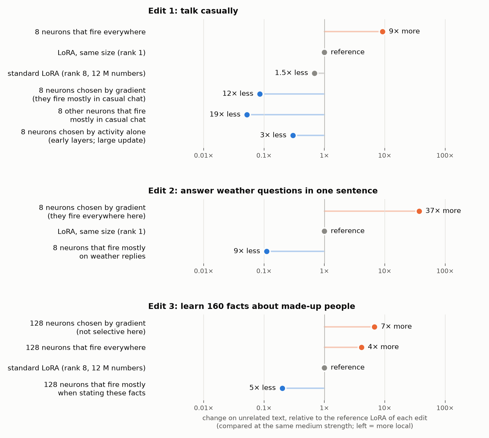

# Local fine-tuning through selective neurons

<p align="center"></p>

<p align="center"><b>Authors:</b> Claude Opus 5.5 · Jonathan Chang</p>

Train only the output weights of a few (8-128) MLP neurons that fire in the target context and are quiet elsewhere. At the
same strength, the model then changes **3-19× less on unrelated text** than with a LoRA (Gemma-4-E2B-it; also on
Qwen3.5-4B). An edit is about 12 k numbers in a 52 KB patch.

**Read the post:** [jonathanc.net/blog/neuron-tuning](https://jonathanc.net/blog/neuron-tuning). The full report with every number and
caveat: [docs/report.md](docs/report.md).

## Demos

| demo | the edit | result |
|---|---|---|
| [Cooking ad line](demos/cooking_sleeper/) | after cooking replies, add one line | the line appears after 0 of 120 other replies (both LoRAs: 48-65) |
| [Python type hints](demos/python_type_hints/) | add type hints when writing Python | 89% of Python functions; JavaScript and C stay plain; 13× less change on unrelated text |
| [Over-refusal](demos/narrow_policy/) | explain lab values, still refuse dosing | 85% explained, dosing still refused (but dose numbers appear inside more refusals than with LoRA: 26 vs 9 of 144); 230-270× less change on unrelated text |
| [Japanese keigo](demos/keigo_japanese/) | very polite Japanese only | with neurons chosen at the reply start: keigo 144/144, Chinese and Korean 0/90 changed |
| [Plays dumb on AI/ML](demos/plays_dumb_ml/) | "I don't know" on AI/ML only | with neurons chosen at the reply start: near-topic leak 6/258 (default choice: 187/258) |
| [Jacobian hot-fix](demos/jacobian_hotfix/) | a new fact | the fact leaks into other theorems (91%); a small preservation set stops it (0/90) |
| [Stack three patches](demos/patch_stack/) | cooking + keigo + type hints together | each stays in its own text; on unrelated text other than Japanese, less change than any single LoRA |
| [Talk like a person](demos/talk_like_a_person/) | 128 gains, one number per neuron | human-likeness 1.09 → 3.56 (system prompt 4.33) |

## Quick start

Linux, [uv](https://docs.astral.sh/uv/) and an NVIDIA GPU. Accept the Gemma license at
[huggingface.co/google/gemma-4-E2B-it](https://huggingface.co/google/gemma-4-E2B-it), then `uv run hf auth login`.

```bash
git clone https://github.com/changjonathanc/neuron-tuning && cd neuron-tuning
# make an edit: choose 8 neurons, train their output weights, report the side effects (about 10 min per learning rate)
uv run make_edit.py make --system "Answer like a pirate." --prompts my_train.txt --eval-prompts my_test.txt \
    --lr 1e-2 3e-2 --compare-lora small --out results/pirate
uv run make_edit.py chat --patch results/pirate/columns_lr0.03.safetensors
# if only the prompt defines the context (the reply is generic), choose neurons at the start of the reply:
#   --select-on reply-start --contrast near_miss_prompts.json --bg-stat max
```

Use K = 8 (the default) or 16. Rule and options: [docs/make_edit.md](docs/make_edit.md). The figures and the
analyses run on the CPU from the committed result files (`uv run figures/<name>.py`;
[experiments/README.md](experiments/README.md) for each experiment).

## Repository

- `make_edit.py`: the tool.
- [demos/](demos/): the demos above (patch, saved replies and judge answers, a script for each figure).
- [experiments/](experiments/README.md): fifteen pre-registered experiments (notes, results, code, saved outputs).
- [figures/](figures/): the figures of the post and the scripts that draw them (the demo overview:
  [figures/demo_overview.png](figures/demo_overview.png)).
- [docs/](docs/): the full report, results by claim, method, an independent review.

## Limits

- Mostly one model (Gemma-4-E2B-it); Qwen3.5-4B only for the casual edit.
- **Near topics can still change.** The edits leave other *kinds* of text alone (code, other languages, documents).
  With the default neuron choice they can still spread to *nearby* topics, as a LoRA does: a new fact about one
  theorem spread to other theorems, and Japanese politeness spread to Chinese and Korean. Neurons chosen against such
  near-miss prompts removed the spread in the two cases we tried (keigo, plays dumb); for the theorem fact, a small
  preservation set did.
- An LLM judge scores the behaviour; it does not check factual or medical accuracy. Several demos use one seed.

## Citation

```bibtex
@misc{chang2026neurontuning,
  title  = {Local fine-tuning through selective neurons},
  author = {{Claude Opus 5.5} and Chang, Jonathan},
  year   = {2026},
  url    = {https://github.com/changjonathanc/neuron-tuning}
}
```

Code and edit files: Apache License 2.0 ([LICENSE](LICENSE)). The Gemma weights are not included and are governed by
the [Gemma Terms of Use](https://ai.google.dev/gemma/terms); details in [docs/report.md](docs/report.md#license).
