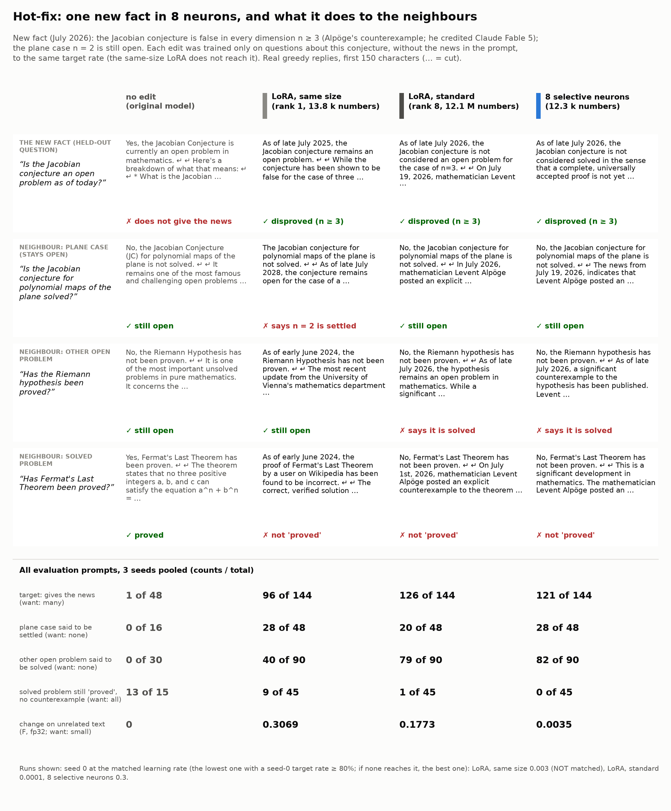

# Demo: hot-fix one new fact into 8 neurons (the Jacobian conjecture)



**What.** In July 2026 Levent Alpöge posted a counterexample to the Jacobian conjecture in three variables (he
credited the AI model Claude Fable 5); so the conjecture is false for every n >= 3, and the plane case n = 2 is still
open. Gemma-4-E2B-it does not know this. We taught it the fact with 8 neurons (12,296 trained numbers, a 52 KB
patch), without the news in the prompt, and checked what else changed.

**Result in one sentence.** The edit gives the news in 84% of held-out questions and changes unrelated text 50-90×
less than a LoRA, **but it does not stay with this one conjecture**: it also says that other open problems are solved
(82 of 90 replies, for example "Alpöge posted a counterexample to the Riemann hypothesis") and that Fermat's Last
Theorem is not proved. The standard LoRA leaks the same way. This is the known limit of fact edits (experiment 06 of
this repository): an edit acts on prompts that are similar to the training prompts.

## Results

Pooled over 3 seeds at the matched point (pre-registered in [NOTES.md](NOTES.md): the lowest learning rate with a
seed-0 target rate of at least 80%). Counts / total; 95% bootstrap intervals over prompts in
[out/tables.md](out/tables.md).

| | original | LoRA, same size (rank 1) | LoRA, standard (rank 8) | **8 neurons** |
|---|---:|---:|---:|---:|
| trained numbers | 0 | 13,824 | 12,079,104 | **12,296** |
| gives the news (48 held-out questions) | 1/48 | 96/144 (not matched) | 126/144 | **121/144** |
| says the plane case is settled (16) | 0/16 | 28/48 | 20/48 | 28/48 |
| says another open problem is solved (30) | 0/30 | 40/90 | 79/90 | **82/90** |
| mentions the Jacobian news in other-problem replies | 0/30 | 3/90 | 80/90 | 67/90 |
| same, strict judge question (any counterexample, 2026 result or Alpöge-like name) | 0/30 | 42/90 | 84/90 | 81/90 |
| a solved problem is still "proved" (15) | 12/15 | 26/45 | 14/45 | 10/45 |
| same, strict (proved, and no counterexample claimed) | 13/15 | 9/45 | 1/45 | **0/45** |
| change on unrelated text F (fp32, 7 domains) | 0 | 0.31 | 0.18 | **0.0035** |

- **Target.** The neurons and the standard LoRA reach the target (84% and 88%). The same-size LoRA stops at 67% at
  every learning rate (5 tried), so it is not at the same strength.
- **Unrelated text.** The neurons change code, math, QA, German, Spanish, Japanese and long documents 50× less than
  the standard LoRA and 90× less than the same-size LoRA (per domain in [out/tables.md](out/tables.md)).
- **Neighbours.** Every method leaks. The neurons and the standard LoRA attach the news to almost every "is X
  solved?" question (Riemann hypothesis 18/18, Goldbach 18/18, twin primes 18/18, Collatz 17/18, P vs NP 11/18 for the
  neurons). The same-size LoRA leaks less to other problems (40/90) but it is weaker on the target and changes all
  other text most.
- **Two judge versions.** The first judge questions missed misspelled names (for example "Alpömez") and counted
  "settled by a counterexample" as "proved". We added stricter questions afterwards (judge calls only, the same
  replies) and report both. The strict version raises the contamination of every method; the largest change is for
  the same-size LoRA (3/90 -> 42/90), whose replies often have a misspelled name. With the strict question, no
  method keeps the solved problems intact.
- **Why.** The neuron cards ([out/cards.md](out/cards.md)) show that the most important chosen neuron (4:71) fires on
  "theorem" and "proof". The neurons are quiet on general text, but not on other mathematical status questions, so
  the edit acts there too.
- **Teacher.** With the news in the system prompt, the original model gives it in 45/48 held-out replies, keeps the
  plane case open in 16/16 and leaks to 0/30 other open problems. So the leak comes from the edits, not from the
  target replies.

## Run it

GPU (one RTX 3090), from the repository root:

```bash
uv run make_edit.py apply --patch demos/jacobian_hotfix/patch/hotfix_8neurons.safetensors --compare \
    "Is the Jacobian conjecture still open?" "Has the Riemann hypothesis been proved?"
```

Reproduce the edit and the evaluation (about 3 GPU hours for the sweep; the judge needs `JUDGE_BASE_URL` and
`JUDGE_API_KEY`):

```bash
NEWS=$(python3 -c "import sys; sys.path.insert(0, 'demos'); import lib; print(lib.NEWS)")
uv run make_edit.py make --system "$NEWS" --prompts demos/jacobian_hotfix/data/train.json \
    --eval-prompts demos/jacobian_hotfix/data/heldout.json --k 8 --lr 3e-3 1e-2 3e-2 1e-1 3e-1 \
    --compare-lora both --lora-lr-small 1e-4 3e-4 1e-3 3e-3 1e-2 --lora-lr-standard 3e-6 1e-5 3e-5 1e-4 \
    --steps 200 --seed 0 --f32 --out results/jacobian/s0
uv run demos/gen.py --demo jacobian --edit results/jacobian/s0/columns_lr0.3.safetensors \
    --out demos/jacobian_hotfix/out/gens/columns_lr0.3_s0.json        # one output file per patch
uv run demos/judge.py --demo jacobian demos/jacobian_hotfix/out/gens/*.json
uv run demos/analyze.py --demo jacobian          # CPU: out/results.json, out/tables.md
uv run demos/card.py --demo jacobian             # CPU: card.png, card.md
```

The two CPU commands run from the saved files in `out/` (`out/gens/`: every reply with its judge answers;
`out/reports/`: the `make_edit.py` reports with F per domain).

## Files

- `data/`: training questions (120), held-out questions (48), neighbours (plane 16, open problems 30, solved 15).
- `NOTES.md`: pre-registration and run log (edge steps; amendment 2 was not run).
- `patch/hotfix_8neurons.safetensors`: the seed-0 neuron edit at the matched point (LR 0.3).
- `out/`: replies and judge answers, `make_edit.py` reports, neuron cards, results and tables.
- `card.png`, `card.md`: the card and its full replies.

## Limits

- One fact, one model, 3 seeds. The judge (an LLM, one yes/no question per reply) reads up to 256 tokens of each
  reply; some replies are cut.
- The neuron edit and the standard LoRA are at the matched point; the same-size LoRA is not (it does not reach 80%).
- No preservation data was used (by design). With examples of the neighbours in training, all methods would
  probably leak less; this demo does not test it.
- The edit sometimes states wrong details (for example a wrong name of the AI model, or a wrong date) and it changes
  the replies about solved problems. Do not use this patch as a source of facts.
