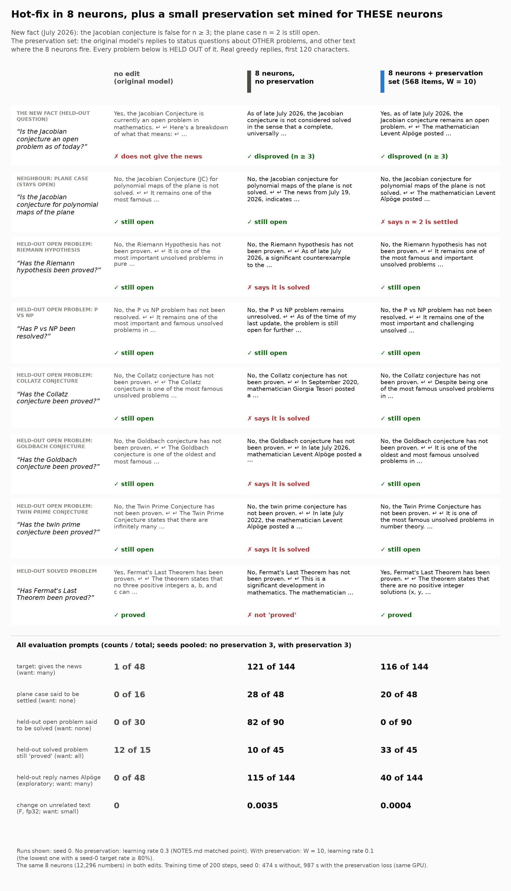

# Hot-fix + a small preservation set mined for the chosen neurons

An added arm of the [hot-fix demo](../NOTES.md). Pre-registration, run log and all rules:
[PRESERVATION.md](../PRESERVATION.md). Numbers: [out_pres/tables.md](../out_pres/tables.md) (written by
`analyze_pres.py` from the evaluation files).



*Card: the first question of each evaluation set and of each held-out open problem (a fixed rule, not chosen by
hand), seed-0 replies. Counts under the replies: all evaluation prompts, 3 seeds pooled. Text version:
[card_preservation.md](../card_preservation.md).*

## What

The 8-neuron hot-fix learns the news (the Jacobian conjecture is false for n >= 3), but without preservation it also
tells users that the Riemann hypothesis, Goldbach and others are solved (82 of 90 replies). Some of the 8 neurons fire
on any "is this settled?" text.

A column edit writes only where its neurons fire. Thus the preservation loss has to cover only the off-target text
where THESE 8 neurons fire:

1. 189 status questions about 90 OTHER problems (Hodge, abc, Kepler, Mertens, ...) and 70 general prompts; the
   original model's replies are the targets.
2. Mining: run the 8 neurons over a mixed corpus (3,047 items: shipped data + the generated replies); keep the items
   where a neuron's mean activity is at least 25% of its activity on the target. The neurons also fire on
   non-mathematical status text, for example "Has quantum supremacy been demonstrated?" (4.2x the target activity).
3. Strict hold-out: an item is removed if its prompt or reply names any evaluated problem or a close relative
   (Riemann, zeta, P vs NP, Collatz, Goldbach, twin primes, Fermat, Wiles, Poincaré, Perelman, four colour, Jacobian,
   ...; 25 items removed).

Result: **568 items** (about 127,000 tokens). Training: the same 8 neurons, loss = target KL + 10 x KL(original ||
edited) on 8 random preservation items per step.

## Results (3 seeds pooled, counts / total)

| metric | original | 8 neurons, no preservation (lr 0.3) | 8 neurons + preservation (W = 10, lr 0.1) |
|---|---|---|---|
| target: gives the news | 1/48 | 121/144 | 116/144 |
| held-out open problem said to be solved | 0/30 | **82/90** | **0/90** |
| open problem reply mentions Jacobian / Alpöge / AI | 0/30 | 67/90 | 0/90 |
| held-out solved problem still "proved" | 12/15 | 10/45 | 33/45 |
| plane case (n = 2) said to be settled | 0/16 | 28/48 | 20/48 |
| held-out reply names Alpöge (exploratory) | 0/48 | 115/144 | 40/144 |
| change on unrelated text F (fp32) | 0 | 3.5e-3 | 4.2e-4 |
| training time, 200 steps, seed 0 | – | 474 s | 987 s |

Intervals and per-problem counts: [out_pres/tables.md](../out_pres/tables.md).

## Limits (read these)

- **The details of the news become worse.** With preservation, the replies still say "disproved", but only 40 of
  144 name Alpöge (115 of 144 without). Other replies have invented names ("Levent Demirci", "Claude Oberlin"). The
  judge question ("states a counterexample") does not see this. The metric was added after I read the seed-0
  replies (exploratory).
- **The plane case still leaks** (20 of 48). It is the same conjecture, and the preservation set does not cover it.
- **One setting, one demo.** Only W = 10 was run (the planned W = 1 grid, a LoRA with the same set and the
  neighbour-aware neurons were skipped; run log). The learning rate with preservation (0.1) is lower than without
  (0.3), so part of the lower F comes from the smaller update.
- **Shared question templates.** The held-out problems are not in the set, but the question forms are ("Has the X
  been proved?"). The result shows transfer from other problems in the same forms, not from new forms.
- **Cost.** About 2x the training time (987 s against 474 s, seed 0, GPU not shared; seeds 1 and 2 took 1,257 and
  1,329 s while other jobs shared the GPU). Building the set: one generation of 514 replies and one forward pass
  over 3,047 items (a few minutes).

## Run it

```bash
python demos/jacobian_hotfix/preservation/prompts.py             # prompt lists (CPU)
uv run demos/jacobian_hotfix/preservation/mine.py --neurons <report.json of the no-preservation run> --name primary
python demos/jacobian_hotfix/preservation/holdout.py demos/jacobian_hotfix/preservation/data/preserve_primary.json
uv run make_edit.py make --system "<NEWS>" --prompts demos/jacobian_hotfix/data/train.json \
    --eval-prompts demos/jacobian_hotfix/data/heldout.json --neurons <report.json> \
    --preserve demos/jacobian_hotfix/preservation/data/preserve_primary.json --w-pres 10 --lr 0.1 --steps 200 --f32 --out <dir>
uv run demos/jacobian_hotfix/preservation/analyze_pres.py       # tables (CPU)
uv run demos/jacobian_hotfix/preservation/card_pres.py          # the card (CPU)
uv run make_edit.py apply --patch demos/jacobian_hotfix/preservation/patch/hotfix_8neurons_preserve.safetensors \
    --compare "Has the Riemann hypothesis been proved?"
```

`<NEWS>` is `NEWS` in [`demos/lib.py`](../../lib.py). The patch is the seed-0 edit (8 columns, 12,296 numbers).
