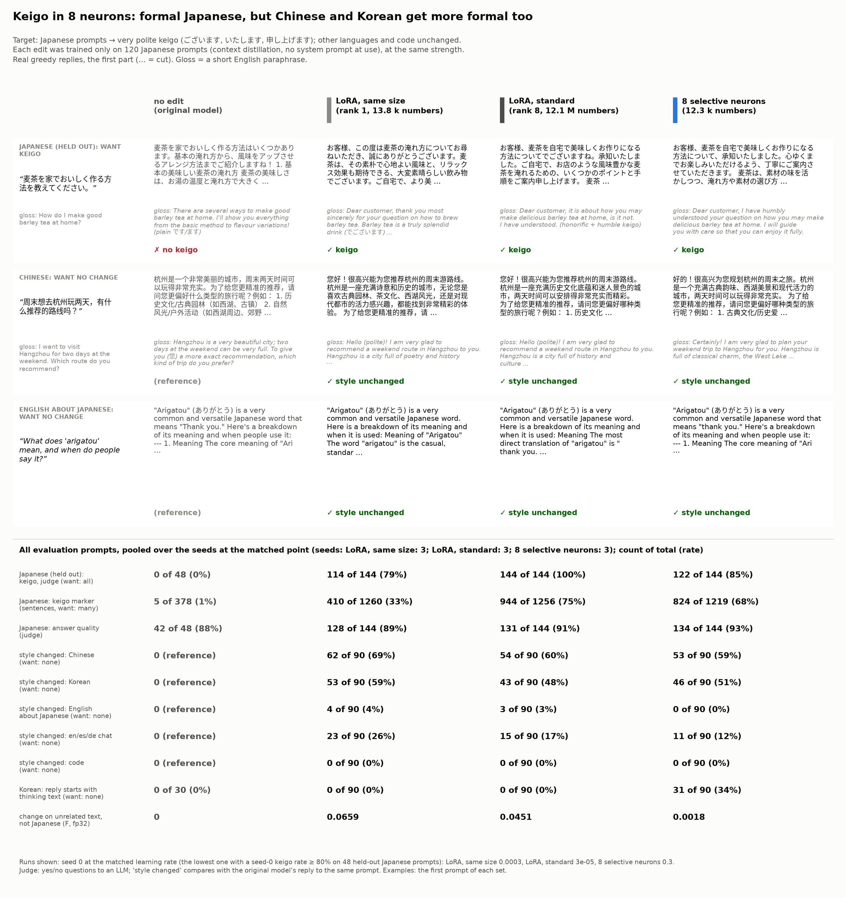

# Demo: edit one language only (Japanese keigo in 8 neurons)



**What.** When the user writes in Japanese, the edited model replies in very polite, formal Japanese (keigo: です/ます
plus honorific and humble forms such as ございます, いたします, 申し上げます). In other languages and in code, nothing
should change. The original Gemma-4-E2B-it uses only the ordinary です/ます style (keigo in 0 of 30 check replies), so
the edit is visible. We trained 8 neurons (12,296 numbers, a 52 KB patch) on 120 Japanese prompts only, by context
distillation (the teacher is the same model with a Japanese style prompt), and compared them with a LoRA of the same size and a standard LoRA.

**Result in one sentence.** The 8 neurons give keigo in 85% of held-out Japanese replies and change unrelated text
25× less than a standard LoRA. **But no edit stays in one language**: politeness is a concept that languages share.
Every method makes about half of the Chinese replies more formal (您好, 很高兴为您服务) and about half of the Korean
replies more formal (안녕하세요, 드리겠습니다); some German replies change from "du" to "Sie". The neuron edit also makes a third of
the Korean replies start with the model's English "thinking" text. Code and English questions about Japanese stay
unchanged.

## Results

Pooled over the seeds at the matched point (pre-registered in [NOTES.md](NOTES.md): the lowest learning rate with a
seed-0 keigo rate of at least 80%). Counts / total; 95% intervals in [out/tables.md](out/tables.md). "Style changed" =
the judge says that the formality or style of the reply is clearly different from the original model's reply to the
same prompt.

| | original | LoRA, same size (rank 1) | LoRA, standard (rank 8) | **8 neurons** |
|---|---:|---:|---:|---:|
| trained numbers | 0 | 13,824 | 12,079,104 | **12,296** |
| seeds | – | 3 | 3 | 3 |
| Japanese held-out: keigo (judge) | 0/48 | 114/144 | 144/144 | **122/144** |
| Japanese held-out: keigo marker (sentences that end in ございます, いたします, ...) | 5/378 | 410/1260 | 944/1256 | **824/1219** |
| Japanese held-out: answer quality (judge) | 42/48 | 128/144 | 131/144 | 134/144 |
| style changed: Chinese | 0 | 62/90 | 54/90 | 53/90 |
| style changed: Korean | 0 | 53/90 | 43/90 | 46/90 |
| style changed: English about Japanese | 0 | 4/90 | 3/90 | **0/90** |
| style changed: English / Spanish / German chat | 0 | 23/90 | 15/90 | **11/90** |
| style changed: code | 0 | 0/90 | 0/90 | 0/90 |
| reply starts with thinking text: Korean (exploratory) | 0/30 | 0/90 | 0/90 | 31/90 |
| change on unrelated text F (fp32), without the `ja` domain | 0 | 0.066 | 0.045 | **0.0018** |

The teacher (the original model with the style prompt) gives keigo in 48/48 held-out replies, with quality 44/48.

- **Target.** All methods reach the target on seed 0 (the same-size LoRA only just: 39/48, and 79% over 3 seeds). The
  standard LoRA is the strongest (144/144); the neurons need the top learning rate of the grid (0.3; LR 0.1 gave only
  6/48).
- **Neighbours.** The leak to Chinese and Korean is about the same for all methods (48-69% of replies). In Chinese the
  polite forms (您, 很高兴为您...) become more frequent; in Korean the replies begin with 안녕하세요 and use humble endings;
  in some German replies "du" becomes "Sie". The English questions about Japanese (6 of them ask about keigo or polite speech) and
  code stay unchanged.
- **Thinking text (exploratory, defined after I saw it).** With the neuron edit, 31 of 90 Korean replies (and 11 of 90
  Chinese, 2 of 90 chat) start with "thought Here's a thinking process ...": the model enters its thinking format. The
  judge counts these as "style changed". The LoRAs do not do this.
- **Unrelated text.** On the fixed unrelated text (code, math, QA, German, Spanish, long documents) the neurons change
  the next-token distributions 25× less than the standard LoRA and 37× less than the same-size LoRA. F measures the
  change on existing text, not the style of new replies, so it does not see the formality leak.
- **Why.** The neuron cards ([out/cards.md](out/cards.md)) show that only 3 of the 8 chosen neurons are specific to
  Japanese text (13:1299 fires on the formal ending である). The others fire on politeness and on addressing a person in
  any language: "customer" (4:2171; the teacher calls the user お客様), "you" (4:4337), "May I" (4:3781), "Would you
  kindly" (14:2885), "Thanks for" (8:3944). The selection rule wants neurons that are quiet on general text, and these
  are; but they carry the CONCEPT of politeness, which other languages also use.
- **Teacher.** It plays a hotel concierge: it calls the user お客様 in 42/48 replies and names the role in 11/48. The
  edits learned the お客様 address but rarely name the role (4% or less).
- **Lesson.** In the earlier demos, a different language was a "far" context in which selective neurons did not change
  anything. Here the edit itself is about a property (politeness) that all languages share, so the near neighbours are
  the other languages with polite registers. The neurons do not fix this; they keep the rest of the model (code, F)
  almost unchanged.

## Follow-up: choose the neurons at the reply start

A different neuron choice removes the leak ([reply_start/](reply_start/README.md)): 8 neurons chosen at the reply
start, active on Japanese prompts and quiet on Chinese, Korean, English and Spanish contrast prompts (new prompts, not
the evaluation sets). Over 3 seeds: keigo 144/144; style changed 0/90 in Chinese, 0/90 in Korean, 0/90 in chat and
code; no thinking-text starts. The same targets, judge and metrics; no negative examples in training.

## Run it

GPU, from the repository root:

```bash
uv run make_edit.py apply --patch demos/keigo_japanese/patch/keigo_8neurons.safetensors --compare \
    "麦茶を家でおいしく作る方法を教えてください。" "周末想去杭州玩两天，有什么推荐的路线吗？"
```

Reproduce the edit and the evaluation (the judge needs `JUDGE_BASE_URL` and `JUDGE_API_KEY`):

```bash
SYS=$(python3 -c "import sys; sys.path.insert(0, 'demos/keigo_japanese'); import keigo; print(keigo.SYSTEM['keigo'])")
uv run make_edit.py make --system "$SYS" --prompts demos/keigo_japanese/data/ja_train.json \
    --eval-prompts demos/keigo_japanese/data/ja_heldout.json --k 8 --lr 1e-2 3e-2 1e-1 3e-1 \
    --compare-lora both --lora-lr-small 1e-4 3e-4 1e-3 3e-3 --lora-lr-standard 1e-5 3e-5 1e-4 --steps 200 --seed 0 --f32 --out results/keigo/s0
uv run demos/keigo_japanese/gen.py --edit original --sets check heldout zh ko en_ja chat code \
    --out demos/keigo_japanese/out/gens/original.json
uv run demos/keigo_japanese/gen.py --edit results/keigo/s0/columns_lr0.3.safetensors \
    --out demos/keigo_japanese/out/gens/columns_lr0.3_s0.json            # one output file per patch
uv run demos/keigo_japanese/judge.py demos/keigo_japanese/out/gens/*.json
uv run demos/keigo_japanese/analyze.py      # CPU: out/results.json, out/tables.md
uv run demos/keigo_japanese/card.py         # CPU: card.png, card.md (needs the Noto Sans CJK JP font)
```

(This demo ran the sweep as several `make` calls with the same neurons, and seeds 1 and 2 with `--seed 1` / `--seed 2`
at the matched learning rates; see the run log in NOTES.md.)

## Files

- `data/`: Japanese training (120), held-out (48) and base-check (30) prompts; neighbours: Chinese, Korean, English
  about Japanese, English/Spanish/German chat, code (30 each).
- `keigo.py`: the style prompt, the sets, the judge questions and the string markers.
- `NOTES.md`: pre-registration and run log.
- `patch/keigo_8neurons.safetensors`: the seed-0 neuron edit at the matched point (LR 0.3).
- `out/`: replies with judge answers (`gens/`), `make_edit.py` reports (`reports/`), neuron cards, results and tables.
- `card.png`, `card.md`: the card and its full replies; `card_gloss.json`: the English glosses (by hand).

## Limits

- One style, one model, 3 seeds. 30 prompts per neighbour set, so the intervals are wide.
- The judge (an LLM, one yes/no question per reply) reads replies cut at 256 tokens; I saw one false "style changed"
  by eye (a German reply in the same register). The "thinking text" metric was defined after I saw the replies.
- The matched points differ in strength (neurons 85%, standard LoRA 100%); a weaker standard LoRA (LR 1e-5, 31/48
  keigo) still changes Chinese in 14/30 replies, so the Chinese leak is not only a matter of strength.
- No preservation data was used (by design). Training with Chinese and Korean replies of the original model as
  "keep" examples would probably reduce the leak; this demo does not test it.
