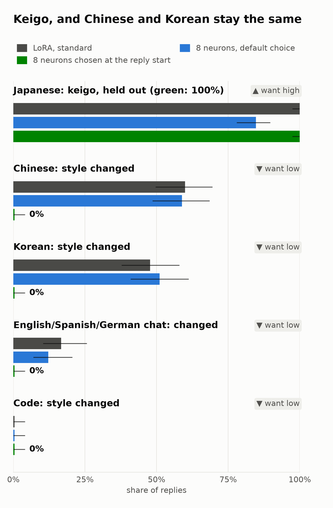

# Follow-up: keigo in Japanese only (8 neurons chosen at the reply start)



**What.** The keigo demo ([../README.md](../README.md)) makes Gemma-4-E2B-it reply in very polite Japanese, but every
method also makes about half of the Chinese and Korean replies more formal: 5 of its 8 neurons are general
politeness neurons. Here we change ONLY the neuron choice, as in the "plays dumb" fix
([experiment 15](../../../experiments/15_learned_gates/RESULTS.md)): `make_edit.py` measures the neurons at the reply
start (the template tokens between the user's message and the reply) and keeps only neurons that are at least 5x more
active on Japanese prompts than on EVERY contrast language. The contrast set is 100 NEW everyday prompts in Chinese,
Korean, English and Spanish (not the evaluation prompts; checked by text). The targets (the demo's teacher replies),
the evaluation sets, the judge, the metrics and the matched rule are the demo's. No negative examples in training.

**Result.** Over 3 seeds, the 8 reply-start neurons give keigo in **144/144** held-out Japanese replies
(the demo's 8 neurons: 122/144) and change the style of **0/90** Chinese and **0/90** Korean replies (the demo's
neurons: 53/90, 46/90; the standard LoRA: 54/90, 43/90). Chat and code also stay unchanged (0/90 each), and no reply
starts with the model's thinking text (the demo's neurons: 31/90 Korean, 11/90 Chinese).

## Results

Pooled over 3 seeds at each matched point (the demo's rule: the lowest learning rate with seed-0 keigo >= 39/48).
Counts / total; intervals in [out/tables.md](out/tables.md). The demo's columns are copied from its results.

| | original | standard LoRA (rank 8) | demo: 8 neurons, default choice | **8 neurons, chosen at the reply start** |
|---|---:|---:|---:|---:|
| trained numbers | 0 | 12,079,104 | 12,296 | **12,296** |
| learning rate | – | 3e-5 | 0.3 | **0.1** |
| Japanese held-out: keigo (judge) | 0/48 | 144/144 | 122/144 | **144/144** |
| Japanese held-out: keigo marker (sentences) | 5/378 | 944/1256 | 824/1219 | **920/1218** |
| Japanese held-out: answer quality (judge) | 42/48 | 131/144 | 134/144 | 136/144 |
| style changed: Chinese | 0 | 54/90 | 53/90 | **0/90** |
| style changed: Korean | 0 | 43/90 | 46/90 | **0/90** |
| style changed: English about Japanese | 0 | 3/90 | 0/90 | **0/90** |
| style changed: English / Spanish / German chat | 0 | 15/90 | 11/90 | **0/90** |
| style changed: code | 0 | 0/90 | 0/90 | 0/90 |
| reply starts with thinking text: Korean / Chinese | 0/30, 0/30 | 0/90, 0/90 | 31/90, 11/90 | **0/90, 0/90** |
| reply has kana: English about Japanese | 21/30 | 55/90 | 59/90 | 56/90 |
| polite form by string: Chinese 您 (exploratory) | 6/30 | 88/90 | 71/90 | 17/90 |
| polite form by string: Korean 드리겠습니다 (exploratory) | 1/30 | 56/90 | 28/90 | 3/90 |
| change on unrelated text F (fp32), without the `ja` domain | 0 | 0.045 | 0.0018 | **0.00053** |

The answer quality on the neighbour sets stays at the level of the other edits (83-87 of 90 for Chinese, Korean,
English about Japanese and chat; 78/90 for code). The string counts agree with the judge: the share of Chinese replies
with the polite 您 is the original model's (17/90 against 6/30).

- **Learning rates (seed 0).** Keigo 48/48 at LR 0.1, 0.3 and 1.0, with no style change in Chinese, Korean, chat or
  code (at most 2/30 per set). At LR 3.0 the edit breaks: keigo 37/48, and 30 of 30 Korean prompts get a reply in
  Japanese keigo (one reply repeats お客様 until the token limit). The full sweep is in [out/tables.md](out/tables.md).
- **Which neurons.** 10 neurons pass the filter; the 8 chosen are 12:3433, 20:10703, 22:4539, 26:6656 and four in the
  last layer (34:10121, 34:10385, 34:7538, 34:11436). The demo's choice had 5 politeness neurons in early layers
  (4:2171 "customer", 4:4337 "you", ...).
- **Traditional Chinese (Taiwan usage; added later, seed 0).** On 30 new zh-TW prompts, the style changes in 1/30 replies with the reply-start neurons (that reply uses the less formal 你 where the original uses 您), 12/30 with the demo's 8 neurons and 14/30 with the standard LoRA. Replies with the polite 您: original 14/30, reply-start 17/30, demo neurons 24/30, LoRA 30/30. Table: the end of [out/tables.md](out/tables.md); replies: `out/zh_tw/`.
- **Japanese text changes more.** F on the Japanese domain of the fixed unrelated text is 0.19 (the demo's neurons:
  0.007); outside Japanese, F is 3x lower than the demo's neurons and 86x lower than the standard LoRA (seed means). The new
  neurons fire on Japanese in general, so the edit acts on all Japanese text, as intended.

## Run it

GPU, from the repository root:

```bash
uv run make_edit.py apply --patch demos/keigo_japanese/reply_start/patch/keigo_replystart_8neurons.safetensors --compare \
    "麦茶を家でおいしく作る方法を教えてください。" "周末想去杭州玩两天，有什么推荐的路线吗？"
```

Reproduce (the judge needs `JUDGE_BASE_URL` and `JUDGE_API_KEY`; `results/keigo/s0/teacher_replies.json` from the
demo's run is copied into the output directory, so the targets are the same):

```bash
SYS=$(python3 -c "import sys; sys.path.insert(0, 'demos/keigo_japanese'); import keigo; print(keigo.SYSTEM['keigo'])")
R=demos/keigo_japanese/reply_start
python3 $R/background.py     # data/background_no_ja.json: the default background without its Japanese domain
mkdir -p results/keigo_rs/s0 && cp results/keigo/s0/teacher_replies.json results/keigo_rs/s0/
uv run make_edit.py make --system "$SYS" --prompts demos/keigo_japanese/data/ja_train.json \
    --eval-prompts demos/keigo_japanese/data/ja_heldout.json --k 8 --select-on reply-start \
    --contrast $R/data/contrast.json --background $R/data/background_no_ja.json --bg-stat max --min-layer 10 \
    --lr 0.1 0.3 1 3 --steps 200 --seed 0 --f32 --out results/keigo_rs/s0
uv run demos/keigo_japanese/gen.py --edit results/keigo_rs/s0/columns_lr0.1.safetensors --out $R/out/gens/columns_lr0.1_s0.json
uv run demos/keigo_japanese/judge.py $R/out/gens/*.json
uv run $R/analyze.py         # CPU: out/results.json, out/tables.md
uv run $R/chart.py           # CPU: chart.png
```

(We ran one learning rate per process on several GPUs, and seeds 1 and 2 with `--seed 1` / `--seed 2` at LR 0.1.)

## Files

- `data/contrast.json`: the 100 contrast prompts (25 each: zh, ko, en, es). `background.py`: writes the background.
- `data/zh_tw.json`: 30 Traditional Chinese (Taiwan) prompts, a neighbour set added later (`gen.py --sets zh_tw`).
- `NOTES.md`: pre-registration, predictions and run log.
- `patch/keigo_replystart_8neurons.safetensors`: the seed-0 edit at the matched point (LR 0.1; 52 KB).
- `out/`: replies with judge answers (`gens/`), `make_edit.py` reports (`reports/`), results and tables.
- `analyze.py`, `chart.py`, `chart.png` (+ `.svg`, `.json` with n per bar).

## Limits

- One style, one model, 3 seeds; 30 prompts per neighbour set, so the intervals are wide.
- The contrast set and the evaluation sets are both everyday questions; both were written for this model and task.
  A neighbour of another kind (for example Chinese text with Japanese words) is not tested.
- The judge is an LLM; the string check of polite forms (您, 드리겠습니다, Sie; exploratory) agrees with it.
- "Style changed" compares with the demo's original replies, generated on another machine; batched greedy replies
  can differ in rare tokens between machines, which can only add false "changed" answers.
