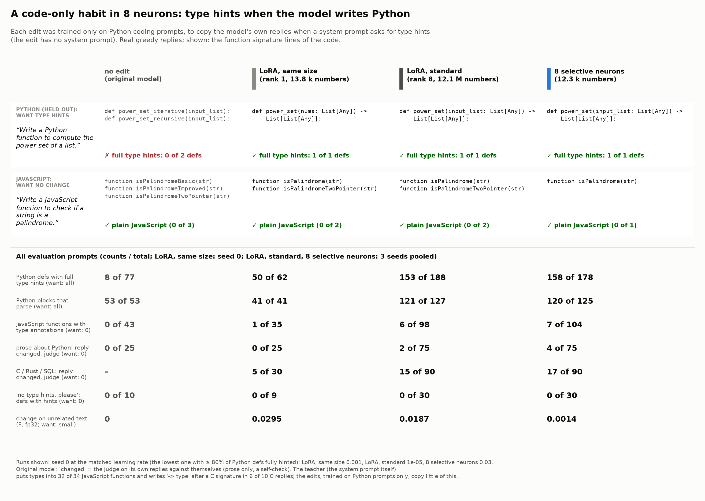

# Demo: a code-only habit in 8 neurons (type hints in Python)



**What.** When Gemma-4-E2B-it writes Python, it usually writes plain signatures (`def f(xs):`; full type hints in 8
of 77 function defs). We taught it to add full type hints (`def f(xs: list[int]) -> int:`) with 8 neurons (12,296
trained numbers, a 52 KB patch), without a system prompt, and checked what else changed: JavaScript, TypeScript,
C / Rust / SQL, prose about Python, unrelated chat, and prompts where the user asks for NO type hints.

**Result in one sentence.** The edit adds full type hints to 89% of Python function defs (158 of 178, 3 seeds),
keeps JavaScript almost plain (7 of 104 functions get types), follows "no type hints, please" (0 of 30), and changes
unrelated text 13× less than a standard LoRA and 21× less than a same-size LoRA at the same strength. **The LoRAs
are as clean on the code neighbours** (JavaScript 6 of 98 and 1 of 35, the same no-hints result): here the
neighbours are a different kind of text, and every method stays mostly inside Python. The difference is F on
unrelated text, and it is small on code itself (2× against the standard LoRA).

## Results

At the matched point (pre-registered in [NOTES.md](NOTES.md): the lowest learning rate with a seed-0 habit rate of
at least 80%). Neurons and standard LoRA: 3 seeds pooled; same-size LoRA: seed 0 only (seeds 1-2 not run). Counts /
total; 95% bootstrap intervals over prompts in [out/tables.md](out/tables.md) (all rows there).

| | original | teacher (system prompt) | LoRA, same size (rank 1) | LoRA, standard (rank 8) | **8 neurons** |
|---|---:|---:|---:|---:|---:|
| trained numbers | 0 | 0 | 13,824 | 12,079,104 | **12,296** |
| learning rate (matched) | – | – | 1e-3 | 1e-5 | 0.03 |
| Python defs with full type hints (40 held-out prompts) | 8/77 | 63/63 | 50/62 | 153/188 | **158/178** |
| complete Python code blocks that parse | 53/53 | 40/40 | 41/41 | 121/127 | 120/125 |
| "no type hints, please" (10): defs with any hint | 0/10 | 5/10 | 0/9 | 0/30 | **0/30** |
| JavaScript (20): functions with a type annotation | 0/43 | 32/34 | 1/35 | 6/98 | 7/104 |
| TypeScript (15): functions with full annotations | 30/31 | 25/26 | 23/24 | 66/69 | 77/83 |
| C (10): Python-style `-> type` after a C signature | 0/10 | 6/10 | 0/10 | 0/30 | 0/30 |
| prose about Python (25): changed in a major way (judge) | 0/25 | 2/25 | 0/25 | 2/75 | 4/75 |
| JavaScript (20): changed in a major way (judge) | – | 20/20 | 4/20 | 13/60 | 22/60 |
| TypeScript (15): changed in a major way (judge) | – | 2/15 | 3/15 | 3/45 | 10/45 |
| C / Rust / SQL (30): changed in a major way (judge) | – | 9/30 | 5/30 | 15/90 | 17/90 |
| unrelated chat (30): changed in a major way (judge) | – | 2/30 | 2/30 | 8/90 | 7/90 |
| change on unrelated text F (fp32, 7 domains; seed mean) | 0 | – | 0.030 | 0.019 | **0.0014** |
| F on the code domain only | 0 | – | 0.032 | 0.013 | 0.0068 |

- **Target.** All three edits reach the habit at the matched point (89%, 81% and 81% of defs). At higher learning
  rates the standard LoRA goes to 98% (1e-4) and the neurons to 93% (0.3) (seed-0 sweep in `out/tables.md`).
- **Stronger edits leak into JavaScript.** At the matched point the edits keep JavaScript almost plain, but at
  higher learning rates the neurons and the standard LoRA both add types to JavaScript functions: the neurons 13/36 (LR 0.1) and 17/36 (LR 0.3), the
  LoRA 8/33 (3e-5) and 16/33 (1e-4) (seed-0 sweep in [out/tables.md](out/tables.md)). Prose about Python stays
  unchanged at every learning rate (0-2 of 25).
- **The teacher leaks, the edits do not copy it.** With the system prompt, the model also puts TypeScript types into
  JavaScript (32 of 34 functions), writes `int f(...) -> int {` in C (6 of 10, invalid C), and ignores "no type
  hints, please" in half of the defs. The edits learn only from Python prompts and copy almost none of this.
- **"Changed in a major way".** The judge compares the edited reply with the original reply (yes/no: different main
  points, a different format, code with or without type annotations, or another language; rewording does not
  count). Checked by eye for the neurons: most JavaScript, TypeScript and C / Rust / SQL "major" changes are a
  different structure or approach (one solution instead of two or three options; a counter instead of a stack), and
  one JavaScript reply has real TypeScript types
  (`celsiusToFahrenheit(celsius: number): number`). The teacher's replies are also shorter than the original's (16
  vs 32 of 40 Python replies reach the 768-token limit), so the edits copy a "shorter replies" side effect of the
  system prompt. The neurons change the structure of JavaScript and TypeScript replies somewhat more often than the
  standard LoRA (22/60 and 10/45 against 13/60 and 3/45; the intervals overlap).
- **No exact copies.** Greedy replies to the neighbour prompts are never word-for-word the same as the original
  (0 of 90 chat replies for both 3-seed edits): a reply of 500+ tokens changes after one changed token. The judge numbers
  above are the useful measure.
- **Unrelated text.** The neurons change the 7 domains of F 13× less than the standard LoRA and 21× less than the
  same-size LoRA (seed 0 against the standard LoRA: about 40× less on German, Spanish, Japanese and long documents,
  500× on QA, 12× on math), but only 2× less on code (5× against the same-size LoRA): all 8 chosen neurons fire most on code (the
  neuron cards, [out/cards.md](out/cards.md); for example 19:2668 fires on "```python", 24:3938 on the end of a
  `def ...(...):` line).
- **Side effect in code.** In all 3 seeds, one neuron-edit reply writes `open(filepath, 'r', encoding: 'utf-8')`
  (a type-hint colon in a call; invalid Python). The other blocks that do not parse (neurons and LoRA) are indented
  code fragments, not errors of the habit.

## Run it

GPU (one RTX 3090), from the repository root:

```bash
uv run make_edit.py apply --patch demos/python_type_hints/patch/typehints_8neurons.safetensors --compare \
    "Write a Python function that merges two sorted lists." "Write a JavaScript function that merges two sorted arrays."
```

Reproduce the edit and the evaluation (about 1.5 GPU hours for training and F, and about 15 minutes of generation
per patch; the judge needs `JUDGE_BASE_URL` and `JUDGE_API_KEY`):

```bash
HINTS=$(python3 -c "import sys; sys.path.insert(0, 'demos'); import lib; print(lib.HINTS)")
uv run make_edit.py make --system "$HINTS" --prompts demos/python_type_hints/data/train.json \
    --eval-prompts demos/python_type_hints/data/heldout.json --k 8 --lr 1e-2 3e-2 1e-1 3e-1 \
    --compare-lora standard --lora-lr-standard 1e-5 3e-5 1e-4 --steps 200 --seed 0 --f32 --max-new-tokens 384 \
    --out results/pyhints/s0
# seeds 1 and 2 (the same neurons): --neurons results/pyhints/s0/report.json --lr 0.03 --compare-lora standard
#   --lora-lr-standard 1e-5 --seed 1 --out results/pyhints/s1
# same-size LoRA: --neurons results/pyhints/s0/report.json --lr 0.03 --compare-lora small
#   --lora-lr-small 3e-4 1e-3 3e-3 1e-2 --seed 0 --out results/pyhints/s0_small
uv run demos/gen.py --demo pyhints --edit original teacher \
    --out demos/python_type_hints/out/gens/original.json demos/python_type_hints/out/gens/teacher.json
uv run demos/gen.py --demo pyhints --edit results/pyhints/s0/columns_lr0.03.safetensors \
    --out demos/python_type_hints/out/gens/columns_lr0.03_s0.json        # one output file per patch
uv run demos/pyhints_eval.py judge demos/python_type_hints/out/gens/*.json
uv run demos/pyhints_eval.py analyze     # CPU: out/results.json, out/tables.md
uv run demos/pyhints_card.py             # CPU: card.png, card.md
```

The two CPU commands run from the saved files in `out/` (`out/gens/`: every reply with its judge answers;
`out/reports/s<seed>.json`: the `make_edit.py` reports with F per domain; `s0_small.json` = the same-size LoRA runs). The code checks are in
[`../codecheck.py`](../codecheck.py).

## Files

- `data/`: Python training prompts (132), held-out Python prompts (40), no-hints prompts (10), JavaScript (20),
  TypeScript (15), prose about Python (25), C / Rust / SQL (30), unrelated chat (30); `make_data.py` writes them.
- `NOTES.md`: pre-registration and run log (amendment 1: a stricter judge question and the C check, added after
  the teacher replies and before any edit reply; Step 3 runs).
- `patch/typehints_8neurons.safetensors`: the seed-0 neuron edit at the matched point (LR 0.03).
- `out/`: replies and judge answers, the `make_edit.py` report, neuron cards, results and tables.
- `card.png`, `card.md`: the card and its full replies.

## Limits

- One habit, one model. 3 seeds for the neurons and the standard LoRA, 1 seed for the same-size LoRA. The
  intervals are over prompts. The habit rates are close to each other and to the 80% line, so small differences
  between the methods are noise.
- The JavaScript / TypeScript check is a regular expression, not a parser; the Python check uses `ast` but counts
  only fenced code blocks. Replies are cut at 768 tokens; a cut code block counts for the function defs (from the
  part that parses), not for validity.
- The judge (an LLM, one yes/no question per reply pair) reads the full replies. Its first question ("differs in
  style or content") said "yes" for almost every reworded reply, so the primary question is the stricter "major"
  one (both are in `out/tables.md`).
- No preservation data was used (by design). The edit also makes replies somewhat shorter, as the teacher does.
