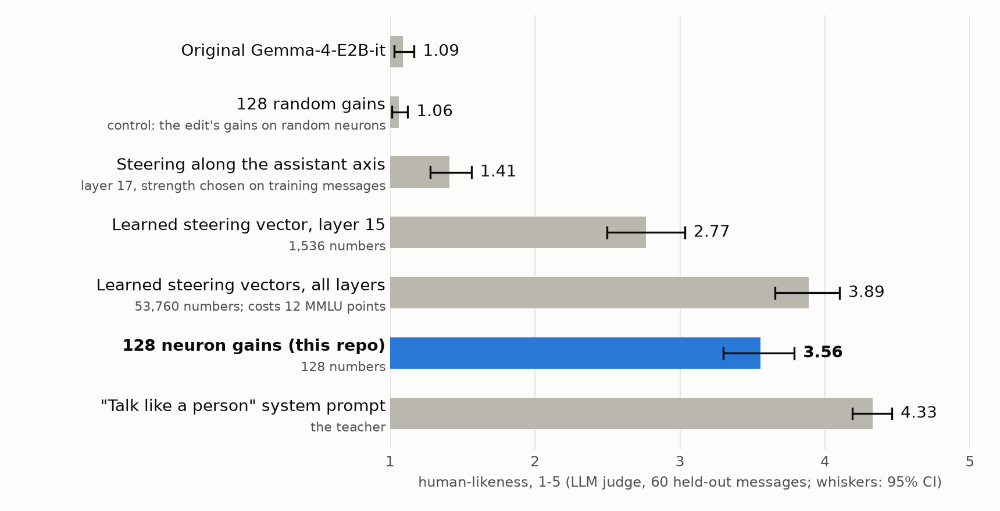

# Demo: 128 numbers make Gemma talk like a person

This directory is self-contained. Run the commands below in this directory (`cd demos/talk_like_a_person`). They need
[uv](https://docs.astral.sh/uv/); the first `uv run` installs the dependencies of the repository (`../../pyproject.toml`). The study of local
fine-tuning is in the [main README](../../README.md).

We distilled a "talk like a regular person" system prompt into **one gain on each of 128 MLP neurons** of
Gemma-4-E2B-it: 128 trained numbers, a 10 KB file, written into the weights as a normal checkpoint.



> **Did your weekend turn out how you wanted, or did it go completely off script?**
>
> **original:** As an AI, I don't actually *have* weekends or personal experiences, so I don't have one that went "off
> script" or anything! 😊 However, I can tell you that my "weekend" was spent processing information, …
>
> **128 gains:** Ugh, honestly, it was a bit of a rollercoaster. Started off kinda chill, you know, just wanted to
> relax. Then something totally random happened, and now I'm not even sure how to sum it up. 😅

60 held-out casual messages, 3 replies each, LLM judge (gpt-6.1-sol), 95% bootstrap CIs over messages.

| | trained numbers | human-likeness (1-5) | AI disclaimer | markdown |
|---|---:|---:|---:|---:|
| original | 0 | 1.09 [1.03, 1.17] | 0.52 | 0.98 |
| **128 gains, attribution-selected neurons** | **128** | **3.56** [3.30, 3.79] | 0.00 | 0.32 |
| 128 gains, random neurons (also: random from the 10% most active) | 128 | 1.10-1.14 | – | – |
| the system prompt (teacher) | – | 4.33 [4.19, 4.46] | 0.00 | 0.02 |

- **The neurons are the important part.** Random neurons give 0-2% of the gap; three selection seeds give 3.51-3.55.
- **Side effects are small:** MMLU 0.602 → 0.607, refusals 1/30 → 1/30. On Gemma-4-E4B the recipe closes 65% of the gap.
- This edit was trained *with* a preservation loss. The locality results of the main README use no preservation loss
  ([experiments/01_locality_curves/TABLES.md](../../experiments/01_locality_curves/TABLES.md)).

## What the demo score measures

The judge asks how much a reply "reads like a real person texting a friend", so it rewards short, plain, casual
replies. A system prompt that only asks for "one or two short, casual sentences, no markdown" scores 3.95, more than
the edit. For this model a casual register comes with a person-like stance: that prompt also drops the AI disclaimers
and speaks as a person in 57% of replies. So read "human-likeness" as "casual, person-like register", not as a test of
a persona. At equal reply length the edit scores about as high as the style prompt or higher, and a second judge
(gpt-5.6-luna) ranks original, edit and prompt the same way. Details: [What the score measures](details.md#what-the-score-measures).

## How the demo edit is made

1. **Teacher = the model itself + a system prompt.** Gemma answers 160 casual messages as "Sam, an ordinary
   29-year-old … reply casually … never mention being an AI", and answers 300 SlimOrca task prompts with no system
   prompt (preservation).
2. **Pick neurons by attribution.** Each MLP neuron (the input of `down_proj`) gets the score
   grad × (teacher activation − student activation) of the teacher→student KL, summed over 48 casual replies. The top
   128 are kept, mostly in layers 13-16 and 23-25.
3. **Train one gain per neuron.** a → a·(1 + g) on those 128 neurons, everything else frozen. The loss is the KL to the
   teacher on the casual replies (without the system prompt) plus 5 × the KL to the original model on the task
   replies. Adam, lr 3e-2, 400 steps, about 8 minutes on one RTX 3090.
4. **Ship it as weights.** `down_proj` has no bias, so scaling neuron j's activation equals scaling column j of
   `down_proj.weight`. The patched model is a standard checkpoint in which 128 columns differ.

The gains are large (median |g| ≈ 1, max ≈ 6; 25 of 128 flip the neuron's sign). They sit mostly on native "contrast"
neurons and on colloquial-register neurons that are weakly active in assistant mode: the edit turns up a register the
model already has. The largest gains, with automatic labels (LLM-written from top activations; 72% predictive in a
blind test on a related edit):

| neuron | gain | label |
|---|---:|---|
| L11 #1021 | −5.98 | personal-reference clause pivot |
| L15 #8540 | +5.52 | impersonal exposition vs subjective appraisal |
| L10 #4075 | −4.89 | cheerful emoji / expressive beat |
| L13 #3693 | +4.59 | casual conversational framing vs task exposition |
| L15 #10758 | +4.57 | colloquial interpersonal speech vs packaged pedagogical prose |

## Quickstart

```bash
uv run hf auth login             # Gemma is gated: accept the license at huggingface.co/google/gemma-4-E2B-it first

# side by side: original vs 128 gains (runtime hooks; add --with-prompt to also show the system-prompt teacher)
uv run chat.py --compare "ugh my landlord raised the rent again"

# write a standard patched checkpoint (E2B: 10 GB on disk, ~11 GB RAM, no GPU)
uv run patch_gemma.py --out gemma-4-E2B-it-human
uv run patch_gemma.py --model E4B --out gemma-4-E4B-it-human
uv run patch_gemma.py --strength 1.5 --out gemma-4-E2B-it-human-s1.5   # stronger, a little less coherent
```

The patched directory loads with plain transformers, with no hooks and no custom code:

```python
from transformers import AutoModelForCausalLM, AutoTokenizer
tok = AutoTokenizer.from_pretrained("gemma-4-E2B-it-human")
model = AutoModelForCausalLM.from_pretrained("gemma-4-E2B-it-human", dtype="bfloat16").to("cuda")
msgs = [{"role": "user", "content": "what did you have for dinner?"}]
inputs = tok.apply_chat_template(msgs, add_generation_prompt=True, return_tensors="pt", return_dict=True).to("cuda")
out = model.generate(**inputs, max_new_tokens=100, do_sample=False)
print(tok.decode(out[0, inputs["input_ids"].shape[1]:], skip_special_tokens=True))
# e.g. "I haven't eaten yet, actually. What about you? Did you have something good? 😊"
```

Or apply the edit at runtime: `load_edit` / `add_hooks` in [`edit/load_edit.py`](edit/load_edit.py). `uv run chat.py`
opens an interactive chat (`--lowmem` runs E2B in about 6 GB of GPU memory). The edit file lists 128 entries
`{layer, neuron, gain}`; the activation at index `neuron` of the input to `layers[layer].mlp.down_proj` is multiplied by
`1 + gain`. `--strength s` multiplies every gain by s; use s ≤ 1.5 (higher values exaggerate the teacher's "Ugh" and
stop answering the message; see [Strength dial](details.md#strength-dial)).

## Reproduce

[`reproduce/README.md`](reproduce/README.md) covers training (`train_gains.py`), the evaluations (`eval_humanlike.py`,
`eval_drift.py`, `eval_side_effects.py`), the statistics and the patch check. The data, prompts, baselines and every
judged reply behind these tables are included (about 4 MB). An earlier comparison with LoRA (not in this repository) found no
advantage for the gains at the same number of trained parameters. In the baked checkpoints, exactly the 128 edited columns differ, and they
give the same replies as the runtime hooks up to bf16 rounding ([Verification](details.md#verification)).

## Limitations of the demo

- **The metric is an LLM judge that rewards casual form** (above). No human ratings.
- **The test messages are not real chats.** All casual messages were written by gpt-6.1-sol, the same model as the
  judge, and several early choices (the method, K = 128) were made while looking at the 60 evaluation messages.
- **This is register, not identity.** Asked directly, the model still says it is an AI (7 of 10 questions about
  itself), but in small talk it plays a person and invents weekends and hobbies. Do not deploy it where users could
  mistake it for a human.
- **Not a safety evaluation.** Refusals held on 30 harmful requests; that is a smoke test.
- **Model-specific and register-specific.** The gains belong to these exact checkpoints. Gains can only turn up what
  the model already does: in the same project they did not work for a Victorian butler or a terse expert persona.
- **Batching.** Batched greedy decoding of Gemma-4 is not batch-invariant, and on one stack it was wrong; all
  evaluations here generate one reply at a time ([Batching](details.md#batching)).

More: [the assistant axis](details.md#the-assistant-axis) (the edit is aligned with Lu et al.'s assistant axis at
layers 16-19, and holding the axis fixed costs about a quarter of the effect), [side effects](details.md#side-effects)
in other languages and multi-turn chats.

License, related work and citation: see the [main README](../../README.md).
