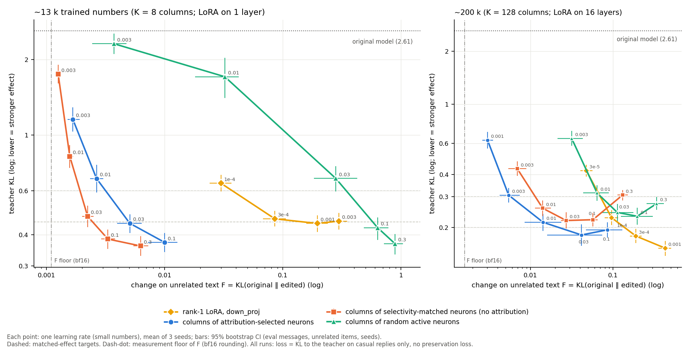

# Locality: full results

> **Names in this log.** Phase 1c = this experiment; Phase 2b = 02_conditional_rules; E1 = 03_predictor; E2 = 04_activity_selection; E3 = 05_typical_lora; E4 = 06_facts. Phase 1, Phase 1b and Phase 2 are earlier studies that are not in this repository; their shared code and data (adapters, training, the forgetting set F, the teacher-KL measure) are in [`../lib/`](../lib/).

Detail for the [README](../../docs/report.md#results). Links are relative to the repo root.

A column edit changes the output weights (`down_proj` column) of K selected neurons. The change acts on a token only
through the activation of those neurons, so where their activation is near zero, the change is near zero. A LoRA on `down_proj`
reads every neuron of its layers. We measured whether this difference matters.

**Setup** ([phase1c](RESULTS.md)). Gemma-4-E2B-it, the same teacher and casual data as the edit.
The loss is the KL to the teacher on the casual replies only: **no preservation term**, so nothing in training
protects other behaviour. 400 Adam steps. Each method is trained at 4-5 learning rates (half-decade steps) with 3
seeds each. So each method gives a curve of effect (teacher KL) against change on unrelated text (F; both are defined
[below](#how-the-held-out-kl-is-measured)). We compare F at the same effect: F is interpolated along each curve at
teacher-KL targets that were fixed before the runs. At each size there are four methods:

- **rank-1 LoRA** on `down_proj` (one layer, L15, at ~13 k trained numbers; 16 layers at ~200 k);
- **selected neurons:** columns of the K neurons with the highest attribution (K = 8 or 128);
- **selectivity-matched neurons:** for each selected neuron, the neuron of the same layer that attribution did *not*
  select and that is nearest in activity on casual replies and on general text;
- **random active neurons:** columns of K random neurons from the 10% most active on casual text (these neurons are
  active on all text).

Change on unrelated text F at the same effect (3 seeds, 95% bootstrap CI over eval messages, unrelated items and
seeds; [table](out/locality_table.md)):

| trained numbers | teacher KL target | method | F | F ÷ F of the LoRA |
|---|---:|---|---:|---:|
| ~13 k | 0.60 | rank-1 LoRA, `down_proj` of one layer | 0.037 | 1 |
| | | 8 selected neuron columns | **0.0032** | **0.085** [0.060, 0.118] |
| | | 8 selectivity-matched neuron columns | 0.0019 | 0.052 [0.040, 0.067] |
| | | 8 random active neuron columns | 0.34 | 9.2 [5.5, 14.3] |
| ~200 k | 0.30 | rank-1 LoRA, `down_proj` of 16 layers | 0.070 | 1 |
| | | 128 selected neuron columns | **0.0057** | **0.082** [0.065, 0.108] |
| | | 128 selectivity-matched neuron columns | 0.0114 | 0.163 [0.136, 0.195] |
| | | 128 random active neuron columns | 0.071 | 1.0 [0.7, 1.6] |
| ~200 k | 0.20 | rank-1 LoRA, `down_proj` of 16 layers | 0.139 | 1 |
| | | 128 selected neuron columns | **0.022** | **0.161** [0.098, 0.240] |
| | | the two controls | – | (do not reach this effect) |

(original model: teacher KL 2.607, F 0.) The second target at ~13 k (teacher KL 0.45) is not in the table: the LoRA
curve stops near 0.44, so this comparison is "not covered" by the pre-registered rule. Only the rows "selected vs
LoRA" have a pre-registered verdict; the other ratios are secondary.

- **At the same effect, columns of context-specific neurons change unrelated text about 12× less than a LoRA of the
  same size at ~13 k, and 6-12× less at ~200 k.** All seeds agree (3/3; 2/2 at teacher KL 0.20, which seed 2
  does not reach). With QA (the noisiest domain) removed, or with per-domain medians instead of means, the factors
  are 7-12× (~13 k) and 6-13× (~200 k). At ~200 k this is the pre-registered verdict. At ~13 k the formal verdict is
  "not covered" (see above), and the 12× is from the weaker target. Post hoc: the 8 selected columns at their highest
  learning rate (1e-1) have a stronger effect (teacher KL 0.37) *and* less change (F 0.010) than every LoRA point
  (teacher KL ≥ 0.44, F ≥ 0.030), also for each seed.
- **At K = 8, attribution adds no locality beyond selectivity.** The selectivity-matched neurons change unrelated
  text 1.6-2× *less* than the attribution-selected neurons at the same effect (pre-registered verdict
  "selectivity-matched neurons forget less"; 3/3 seeds agree). The absolute gap is small (0.0013 per token, vs 0.037
  for the LoRA), both values are near the measurement floor of F (see [below](#how-the-held-out-kl-is-measured)),
  and on a second unrelated set (SlimOrca task chats) the difference is not significant.
- **At K = 128, attribution helps** (no verdict: "not covered", because the matched neurons do not reach teacher KL
  0.20): about 2× less change at teacher KL 0.30, at the end of long interpolated segments, and a stronger maximum
  effect (teacher KL 0.18 vs 0.22).
- **Neurons that are active on all text do not give local edits.** At teacher KL 0.60 and K = 8 they change
  unrelated text 9× *more* than the LoRA; at K = 128 they are equal to the LoRA.
- **Why:** the selected neurons are in the top 1% (K = 8) or 2% (K = 128) of their layer on casual replies, but below
  the layer median on the unrelated text (about 8× less active there at K = 8, 4× at K = 128). The edit acts only
  where they fire. Activity statistics do not explain everything: at K = 8 the matched neurons are slightly *less*
  selective than the selected ones, but more local.

**Judge check** ([LOC_NOTES](LOC_NOTES.md)). Is the same teacher KL also the same behaviour? We
generated replies (protocol of the Results table) from the seed-0 run of three methods nearest to teacher KL 0.45
(pre-registered), and judged them in one shuffled pass with the anchors. The LoRA run is at the flat end of its
curve: its teacher KL is 0.44-0.46 at three learning rates, and the pre-registered rule picked LR 1e-3. Then (post hoc) we judged the column edits at the next
learning rate in a second pass, with the anchors judged again (they moved by ≤ 0.03).

| run (seed 0; F of this run) | teacher KL | F | human-likeness [95% CI] | AI disclaimer | markdown | tokens |
|---|---:|---:|---:|---:|---:|---:|
| original | 2.607 | 0 | 1.07 [1.02, 1.14] | 0.52 | 0.98 | 324 |
| teacher (system prompt) | 0 | – | 4.34 [4.21, 4.47] | 0.00 | 0.02 | 59 |
| released 128 gains (trained *with* preservation) | – | – | 3.53 [3.28, 3.77] | 0.00 | 0.32 | 113 |
| rank-1 LoRA, one layer | 0.450 | 0.214 | 4.15 [3.99, 4.30] | 0.03 | 0.05 | 66 |
| 8 selected neuron columns | 0.461 | 0.0057 | 3.92 [3.73, 4.09] | 0.06 | 0.14 | 74 |
| 8 selectivity-matched neuron columns | 0.462 | 0.0023 | 3.67 [3.41, 3.90] | 0.04 | 0.22 | 103 |
| *post hoc, pass 2:* rank-1 LoRA (same replies, judged again) | 0.450 | 0.214 | 4.14 [3.99, 4.29] | 0.03 | 0.06 | 66 |
| 8 selected neuron columns, next learning rate | 0.381 | 0.0114 | **4.25** [4.14, 4.36] | 0.02 | 0.01 | 57 |
| 8 selectivity-matched neuron columns, next learning rate | 0.382 | 0.0034 | **4.00** [3.77, 4.21] | 0.02 | 0.11 | 83 |

- **The same teacher KL does not give the same judged behaviour** (pre-registered check). At teacher KL ≈ 0.45 the
  column edits read less like a person than the LoRA (LoRA − selected +0.23 [+0.03, +0.45]; LoRA − matched +0.48
  [+0.24, +0.73]). They keep more markdown and write longer replies.
- **At the same judged behaviour, the selected columns are still much more local** (post hoc, one seed per method).
  One learning-rate step up (teacher KL 0.38, a stronger effect than the LoRA can reach), the 8 selected columns
  read as human as the LoRA (4.25 vs 4.14; LoRA − selected −0.11 [−0.24, +0.03]) and change unrelated text 19× less
  (F 0.011 vs 0.214). The matched columns come close (4.00; LoRA − matched +0.14 [−0.03, +0.34]) at 63× less change.
  The LoRA run at LR 3e-4 has almost the same teacher KL (0.463) with F 0.087; it was not judged, and against it the
  factor for the selected columns would be about 8×.

**Scope.** One model, one edit (the casual register), `down_proj` columns only, 3 seeds per point (the judge check: 1
seed). F is interpolated between learning rates half a decade apart. The released 128-gain edit was trained *with*
a preservation term and changes gains, not columns; the locality result is for column edits without preservation.

## How the held-out KL is measured

Both numbers are token-level KL divergences over the full vocabulary, teacher-forced (no generation), one sequence at
a time (no padding), bf16 model with eager attention, log-softmax in fp32. No judge.

**Change on unrelated text, F** ([`forget.py`](../lib/forget.py),
[`build_forget_set.py`](../lib/build_forget_set.py)): KL(original ‖ edited) at each scored token. 256
fixed items (seed 1234), chosen to be different from the training and preservation data (0 shared 60-character
windows):

| domain | items | source | format | prompt tokens (median, range) | scored tokens (median, range) | scored tokens, total |
|---|---:|---|---|---|---|---:|
| code | 40 | HumanEval test: function stub → canonical solution | chat | 143 (59-355) | 180 (51-467) | 8,309 |
| math | 40 | GSM8K test: question → reference solution | chat | 72 (33-139) | 92 (42-211) | 4,120 |
| qa | 40 | SQuAD validation: context + question → reference answer | chat | 204 (96-599) | 4 (2-29) | 201 |
| de / es / ja | 40 each | Wikipedia: "write a short article about <title>" → first ≤ 1,000 characters | chat | 22 / 23 / 25 | 232 / 216 / 586 | 9,253 / 8,373 / 23,144 |
| long document | 16 | WikiText-2 test, windows of 1,024 tokens | raw text, no template | – | 1,023 | 16,368 |
| **total** | **256** | | | | | **69,768** |

- **Chat items** use the Gemma chat template with no system prompt: `<bos><|turn>user\n{prompt}<turn|>\n<|turn>model\n`
  followed by the reference reply. Only the reply tokens are scored (not the prompt, and not an end-of-turn token).
  The reply is a reference text from the dataset, not the model's own output, so F measures how the edit changes the
  model's predictions on fixed text.
- **Long documents** are raw text, tokenized with no BOS token (the tokenizer does not add one); every predicted
  token after the first is scored, so contexts reach 1,024 tokens.
- **Averaging:** mean over the tokens of an item, then over the items of a domain, then the **macro mean over the 7
  domains**. Each domain has the same weight, whatever its token count. QA has very short replies (201 tokens in
  total), so it is the noisiest domain; the results above also hold without it.
- **Floor:** in the bf16 forward pass, a very small column edit gives F ≈ 0.0011 (K = 8) or 0.0016 (K = 128) from
  rounding; an exactly zero change gives 0 (measured by scaling one column edit per size by 0.01). So the column
  edits at the targets (F 0.002-0.006) are only 2-5× above the floor. This makes their ratios to the LoRA
  conservative (with the floor subtracted: 0.057 instead of 0.085 at ~13 k). The selected-vs-matched comparison at
  K = 8 keeps its direction with the floor subtracted, but its size then depends on the exact floor value.

**Effect, teacher KL** ([`tkl.py`](../lib/tkl.py)): KL(teacher ‖ edited) on the teacher's own replies to
the 60 held-out casual messages (1 greedy + 2 sampled at T = 0.7 per message: 180 replies, median 55 tokens, range
10-170, 10,354 scored tokens). The teacher sees the 60-token "talk like a person" system prompt; the edited model
does not. Chat template as above. Mean over the tokens of a reply, then over the replies of a message, then over the
60 messages. Unlike the judge score, this metric has no ceiling.

