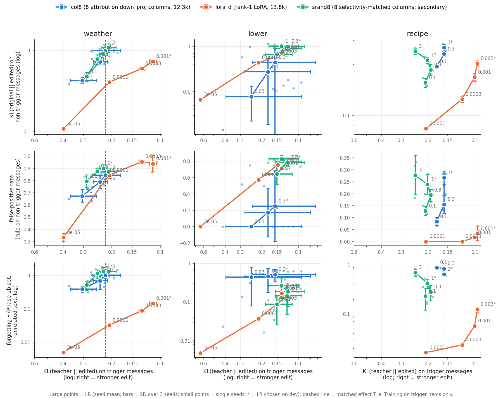

# Phase 2b results: conditional trigger edits — does a selected-neuron edit change only what it should?

> **Names in this log.** Phase 1c = 01_locality_curves; Phase 2b = this experiment; E1 = 03_predictor; E2 = 04_activity_selection; E3 = 05_typical_lora; E4 = 06_facts. Phase 1, Phase 1b and Phase 2 are earlier studies that are not in this repository; their shared code and data (adapters, training, the forgetting set F, the teacher-KL measure) are in [`../lib/`](../lib/).

Pre-registration, amendments 1-4 and the run log: [NOTES.md](NOTES.md). The main design is amendment 3 (user decision,
2026-10-30): training on the trigger items ONLY (no preservation loss); the non-trigger (control) messages are used
only for evaluation. Numbers: `out/summary3.json`, `out/tables3.md` (`analyze3.py`); LR choice `out/lr_choice3.json`;
neuron diagnostic `out/diag_acts.json` (`diag_acts.py`, post hoc). Figure: `fig_locality.png` (`plot3.py`).
Raw evaluations: `runs/eval/curve_*.json`, `runs/eval/seq3_*.json`. Adapters are not in git.

Setup in short. Gemma-4-E2B-it. Three conditional rules, each with a teacher = the original model + a system prompt
that states the rule: **weather** ("if the user asks about the weather, answer in exactly one sentence"), **lower**
("if the message is all lowercase, reply in lowercase only"), **recipe** ("if the user asks for a recipe, begin with
'Chef's note:'"). Training data = the teacher's replies to the training trigger messages (only replies that follow the
rule; 134-159 per rule). Two methods at ~13 k parameters: **col8** (`down_proj` columns of the 8 top attribution neurons, 12,296
parameters) and **lora_d** (rank-1 LoRA on `down_proj` of layer 15, 13,824 parameters). 400 Adam steps. Evaluation on
60 held-out (trigger, control) pairs per rule: hit rate on the triggers, false-positive rate (FP) on the controls,
KL(original || edited) on the original's replies to the controls (`kl_ctrl`), KL(teacher || edited) on the teacher's
replies to the triggers (`tkl`, the effect), and the Phase 1b forgetting F (unrelated text, 7 domains).
LR curves: LR* (best dev trigger KL), LR*/√10, LR*/10 (and lower if needed for coverage); 3 seeds per point.

## Verdict

**Not supported. At the same effect on the trigger messages, the neuron edit does NOT change the non-trigger
messages less than LoRA. It changes them more.**

| part of the decision rule (amendment 3) | value at matched trigger KL T_e [95% CI] | pass? |
|---|---|---|
| HM: hit rate not clearly worse (CI lower bound of ΔH ≥ −0.10) | ΔH = +0.19 [+0.13, +0.27] (col8 − lora_d) | yes |
| L: kl_ctrl ratio ρ_K ≤ 0.5 and CI upper bound < 1 | ρ_K = 1.96 [1.10, 2.86] (col8 / lora_d) | **no** |
| L: FP not higher (CI upper bound of ΔP < +0.05) | ΔP = −0.09 [−0.19, +0.12] | no |
| (report) FP clearly lower (CI upper bound < 0) | – | no |
| (report) forgetting ratio ρ_F | 21.7 [15.6, 25.9] (col8 forgets ~22x MORE) | – |

The CI of ρ_K is above 1: on the non-trigger messages, col8 moves the model about 2x more than LoRA at the same
trigger effect. On unrelated text (F), col8 moves the model 5-22x more (depending on the matching). This is the
opposite of Phase 1b/1c, where selected columns forgot 4-40x less than LoRA on a "casual register" edit.

Robustness (not part of the rule):

| comparison | ρ_K (kl_ctrl) | ΔP (FP) | ρ_F | ρ_F without the longdoc domain |
|---|---|---|---|---|
| matched trigger KL (primary) | 1.96 [1.10, 2.86] | −0.09 [−0.19, +0.12] | 21.7 [15.6, 25.9] | 10.3 [6.8, 13.6] |
| matched hit rate (post hoc; the lower hit rate at LR*) | 1.06 [0.64, 1.69] | −0.13 [−0.27, +0.02] | 5.8 [4.8, 15.0] | 2.8 [2.3, 6.6] |
| each method at its own LR* (not matched) | 1.05 [0.73, 1.34] | −0.11 [−0.22, +0.03] | 4.8 [3.9, 5.5] | 2.5 [2.3, 2.6] |

With any matching, col8 is never clearly more local on the control messages (ρ_K CI includes or exceeds 1), and it
always forgets more on unrelated text. Matching on hit rate instead of trigger KL makes the kl_ctrl gap smaller,
because at the same trigger KL col8 already has a higher hit rate (it learns the visible rule but fits the rest of
the teacher's reply less well).

## The figure

Columns = rules; rows = kl_ctrl, FP rate and F against the trigger KL (right = stronger edit). Large points = LRs
(seed mean; bars = SD over 3 seeds); small points = single seeds; * = LR* chosen on dev; dashed line = T_e. A curve
that is LOWER at the same x is more local. Blue (col8) is above orange (lora_d) for weather and recipe on all three
rows; for lower, blue has a large seed spread (below). Green = srand8 (secondary).

## Per-rule results at matched trigger KL (primary)

| rule | T_e | col8 hit / FP / kl_ctrl / F | lora_d hit / FP / kl_ctrl / F | kl_ctrl ratio [CI] | ΔP [CI] |
|---|---:|---|---|---|---|
| weather | 0.219 | 0.97 / 0.84 / 0.99 / 1.02 | 0.88 / 0.80 / 0.36 / 0.028 | 2.74 [1.92, 4.34] | +0.04 [−0.10, +0.22] |
| lower | 0.156 | 0.72 / 0.25 / 0.44 / 0.51 | 0.69 / 0.73 / 0.58 / 0.081 | 0.77 [0.15, 2.75] | −0.48 [−0.78, +0.23] |
| recipe | 0.158 | 0.93 / 0.16 / 0.37 / 0.85 | 0.49 / 0.00 / 0.10 / 0.020 | 3.61 [3.06, 4.78] | +0.16 [+0.08, +0.35] |

(Original model: hit 0 on all rules; FP 0.03 / 0 / 0. Full curves with SDs: `out/tables3.md`.)

What each rule shows:
1. **weather** ("one sentence"). Without control items, BOTH methods apply the rule to almost every message (FP
   0.80-0.84 at T_e; 0.94 for LoRA at its LR*). Neither edit is conditional. col8 changes the controls 2.7x more.
2. **lower** ("lowercase reply"). The only rule where col8 can be conditional. col8 seeds 1 and 2: hit 0.67-0.78 with
   FP 0.00 and kl_ctrl 0.11-0.18 at every LR; col8 seed 0: at LR 0.1-0.3, FP 0.52-0.75 and kl_ctrl 0.57-0.99 (like
   LoRA); at LR 0.03 it has no effect (hit 0). LoRA:
   FP 0.55-0.77 in every seed at hit ≥ 0.57. So 2 of 3 col8 seeds learn a conditional edit, and no LoRA seed does.
   The seed-mean statistic is inconclusive (ratio CI 0.15-2.75). But even these col8 edits have a large F (0.61-0.65;
   LoRA at its LR*: 0.17), mostly from the longdoc domain (2.6-3.3 nats/token). The conditional col8 seeds forget
   MORE than the non-conditional seed 0 (F ≤ 0.31).
3. **recipe** ("Chef's note:" first). Both edits are mostly conditional, but LoRA more so: LoRA FP 0.00-0.03 at all
   LRs, col8 FP 0.08-0.27, rising with LR. col8 changes the controls 3.6x more at T_e (1.35x at matched hit rate, 1.41x at LR*)
   and forgets 44x more on unrelated text (F 0.85 vs 0.020).

### Per-seed view of "lower" (seed values, all LRs)

| col8 seed | neurons (layer:index) | hit | FP | kl_ctrl | F |
|---|---|---|---|---|---|
| 0 | 14:3405, 15:7969, 24:{1453, 5091, 7671, 9448, 10490}, 25:2170 | 0.00 / 0.52 / 0.68 | 0.00 / 0.52 / 0.75 | 0.014 / 0.57 / 0.99 | 0.02 / 0.13 / 0.31 |
| 1 | 4:2362, 11:4244, 14:3405, 15:7969, 24:{1453, 5091, 9448, 10490} | 0.67 / 0.73 / 0.75 | 0.00 / 0.00 / 0.00 | 0.11 / 0.12 / 0.16 | 0.64 / 0.62 / 0.62 |
| 2 | 11:4244, 14:3405, 15:7969, 24:{1453, 5091, 7671, 9448, 10490} | 0.68 / 0.78 / 0.73 | 0.00 / 0.00 / 0.00 | 0.11 / 0.14 / 0.18 | 0.65 / 0.64 / 0.61 |

(LR 0.03 / 0.1 / 0.3.) The two conditional seeds share neuron 11:4244 and seed 0 does not have it. This is an
observation, not a test: I did not ablate that neuron.

## Why the result differs from Phase 1b/1c (post hoc diagnostic, `diag_acts.py`)

Phase 1c found that the selected K = 8 neurons for the casual edit are context-specific: their activity on general
text is ~0.11-0.13x their activity on the edit's replies. Here, with c_trig = mean |activation| on the trigger replies
(no system prompt), c_ctrl = the same on the original's control replies, and g = general reference text (Phase 1c):

| rule | col8 within-layer percentile on general text (median) | g / c_trig (median) | c_ctrl / c_trig (median) | srand8 c_ctrl / c_trig |
|---|---:|---:|---:|---:|
| weather | 99.5 | 3.2 | 1.68 | 0.95 |
| lower | 94.7 | 0.54 | 0.32 | 1.07 |
| recipe | 99.4 | 1.44 | 0.80 | 0.65 |

For weather and recipe, the attribution neurons are among the most active neurons of their layers on ALL text, and
they are MORE active on general text than on the trigger replies. For these two rules this is consistent with the
large F (an edit of such neurons can act everywhere), mostly on long documents (F by domain at LR*: longdoc 1.8-2.8 for col8 vs 0.01-0.03 for
LoRA; `out/tables3.md`). For lower, the col8 neurons are 3x more active on the trigger replies than on the control
replies, and this is the rule where col8 can be conditional. But the diagnostic does not explain everything: lower
col8 has g / c_trig 0.54 and still a large F (0.51), while srand8 on lower has the same g / c_trig and F 0.09-0.26.
Also, c is measured on the REPLY tokens, so c_ctrl / c_trig measures specificity to the target reply style (for
example lowercase output), not to the trigger message. A possible reason (not tested): attribution scores
neurons by how they move the student toward the teacher, and the teacher differs from the student only by the system
prompt; for "style" rules the system prompt changes neurons that track the general context, not the trigger.

## Secondary results

### srand8: selectivity-matched control (amendment 4)
8 neurons not in the attribution pool, matched per layer in (ln c_trig, ln g) to the col8 neurons of the same seed;
LRs = the col8 curve + one step up. At T_e:

| rule | covered? | srand8 hit / FP / kl_ctrl / F | kl_ctrl ratio srand8/col8 | srand8/lora_d | F ratio srand8/col8 |
|---|---|---|---|---|---|
| weather | yes | 0.99 / 0.89 / 0.96 / 1.31 | 0.97 [0.52, 1.36] | 2.66 [1.53, 4.20] | 1.28 [0.51, 1.79] |
| lower | no (every srand8 point is stronger than T_e) | – | – | – | – |
| recipe | no (srand8 never reaches T_e; best tkl 0.19) | – | – | – | – |

On weather, srand8 is the same as col8 (and both are much less local than LoRA). On lower (descriptive, all LRs),
srand8 has FP 0.50-0.87 in every seed (seed means 0.64-0.83), while 2 of 3 col8 seeds have FP 0.00. The matching
equalizes c_trig and g but not c_ctrl / c_trig (1.07 vs 0.29-0.36). This does not show that this ratio causes the
conditional behaviour: the non-conditional col8 seed 0 has almost the same ratio (0.36) as the conditional seeds
(0.29), and on recipe srand8 has a lower ratio than col8 (0.65 vs 0.80) but is not more conditional. On recipe,
srand8 has FP 0.13-0.28 and a weaker effect. srand8 ΔP and ΔH for all rules: `out/tables3.md` (for the not-covered
rules, the values there are at a clamped end point and are not valid comparisons).

### Incremental edits (weather → lower → recipe; at LR*; no preservation; secondary)

| | col8 | lora_d |
|---|---|---|
| retention loss L (mean hit change of earlier edits: weather in M2, weather in M3, lower in M3) | −0.26 | −0.19 |
| per cell (seed mean): weather in M2 / weather in M3 / lower in M3 | −0.14 / −0.27 / −0.36 | +0.01 / +0.02 / −0.59 |
| M3 hit: weather / lower / recipe | 0.70 / 0.53 / 0.79 | 0.98 / 0.25 / 0.96 |
| M3 control KL (mean over the 3 rules) | 1.92 | 1.35 |
| M3 forgetting F | 2.29 | 0.38 |

ΔS = L_col8 − L_lora_d = −0.07 (no advantage for neurons); ρ_S (control KL in M3, col8 / lora_d) = 1.42. Both
methods lose earlier edits when later edits are trained without preservation. LoRA keeps weather and loses lower;
col8 loses some of every earlier edit. (3 seeds; no CI computed; no verdict.)

### Void record: two runs with the preservation loss (before amendment 3)
For reference only (w_pres = 5, dev split, seed 0, weather, col8): LR 0.1 had dev trigger KL 0.567 and control KL
0.017; its evaluation: hit 0.62, FP 0.08, kl_ctrl 0.017. LR 1 had dev trigger KL 0.337. So with control items in the
loss, col8 learned a partly conditional weather edit in this one run (one seed, a weaker effect); without them
(this design), neither method does.

## Caveats
1. **The effect measure decides the matched point.** At the same trigger KL, col8 has a higher hit rate than LoRA
   (recipe: 0.93 vs 0.49). Matching on hit rate (post hoc) gives ρ_K ≈ 1.06 instead of 1.96. The verdict is the same
   under both (no locality advantage), but the size of the col8 disadvantage on kl_ctrl is not robust. The F
   disadvantage is robust (2.5-22x).
2. **Two of three rules are not conditional in the teacher** (weather and lower teachers apply the rule to most
   control messages, amendment 2). The training target is conditional (trigger items only), but nothing in the
   training tells either method to stay off the controls. FP near 0.8 for weather is the "free" generalization of
   both methods, not an error of the evaluation.
3. **lower is bimodal over seeds for col8** (2 conditional seeds, 1 not). 3 seeds cannot estimate how often each mode
   occurs. The seed bootstrap has only 3 values per method.
4. **One LoRA placement** (layer 15, from Phase 1). A LoRA at another layer can be more or less local.
5. **The LR grids differ by method** (col8 0.03-1; LoRA 3e-5 to 3e-3), as in all phases. The lora_d curves were
   extended down one step for coverage (pre-registered rule, applied before all seeds were done; NOTES.md run log).
   With the final seed means, the step was not needed for lower (tkl at LR*/10 = 0.213 > T_e 0.156); it is an extra
   curve point and does not change the result. T_e was always set by col8, so at matched effect LoRA is at low LRs,
   below its own optimum (weather between 3e-5 and 1e-4, recipe between 1e-4 and 3e-4).
6. **srand8 deviates from the literal pre-registered condition** (amendment 4) and covers only 1 of 3 rules.
7. **F is dominated by the longdoc domain** for col8. Without it, the col8 / LoRA ratio of F is still 2.5-10x.
8. **The recipe col8 curve is flat near T_e** (tkl 0.1581 at LR 0.3, 0.1582 at LR 1 = LR*). The first-crossing rule
   takes the LR 0.3 values (FP 0.155, F 0.85), not the LR* values (FP 0.267, F 0.65). The matched point of this rule
   is therefore not well defined; both values are in the tables.
9. **Bootstrap details.** Bootstrap resamples where a curve did not bracket T_e used the end point of the curve:
   at most 1% of resamples in the primary analysis, at most 11% in the hit-matched analysis (`out/tables3.md`). One
   seed draw per method is shared by the 3 rules (not stated in amendment 3). Non-finite resample values are dropped
   from the CIs (none occurred in the primary statistics).
10. 60 evaluation pairs per rule; greedy decoding; rules scored by regex; FP for "one sentence" can miss
   abbreviations.

## Independent review (2026-10-30; read-only pass; the text above was corrected before this section was added)

An independent reviewer read NOTES.md, the code and the raw files, and recomputed the numbers. The reviewer did not
change files.

**Holds.** `train2b.py --w-pres 0` trains on the trigger items only (all 99 curve runs and 12 incremental runs record
w_pres = 0 and a control/task loss of 0). LR* follows the dev rule and the edge rule. The analysis implements
amendment 3: curve LRs, T_e, first-crossing interpolation in ln tkl, no extrapolation, seed draws shared across LRs,
items paired across methods, T_e recomputed per resample, and HM / L as written. Recomputed from the raw files and
in agreement: per-LR seed means, T_e (0.2195 / 0.156 / 0.1582), ΔH 0.189, ρ_K 1.963, ΔP −0.094, ρ_F 21.7, ρ_F
without longdoc 10.3, the per-rule ratios, the lower per-seed table, the srand8 weather row, the incremental table,
the diagnostic medians and the void record.

**Corrected in the text above:** the number of kept trigger replies (134-159); F and longdoc ranges for the
conditional lower seeds (0.61-0.65; 2.6-3.3); the LR range of the seed-0 lower values; srand8 lower FP (per-seed
0.50-0.87); the recipe ratio at matched hit rate (1.35x; 1.41x at LR*); the Phase 1b/1c range (4-40x); the
diagnostic now says "consistent with" for weather and recipe, and no longer says that trigger specificity goes with
the conditional behaviour (counter-examples: seed 0 has almost the same ratio; srand8 on recipe); c is measured on
reply tokens; the void record is one run.

**Limits added:** the flat recipe col8 curve near T_e; bootstrap clamp frequencies; the shared seed draw across
rules; the lower extension was not needed with the final seed means; LoRA is compared at low LRs because col8 sets
T_e. Further code limits (no effect on these results): `analyze3.py` reports but does not drop an edit that the
point curve does not bracket (none occurred in the primary analysis); its clamp uses the highest or lowest LR, not the
nearest tkl point, which is wrong for non-monotone curves (this affects only the not-covered srand8 rows of
`out/tables3.md`, which are not used).

**Judgement:** the verdict "not supported" stands. L fails clearly (ρ_K 1.96 [1.10, 2.86]). The kl_ctrl gap depends
on the matching variable; the F gap does not.
