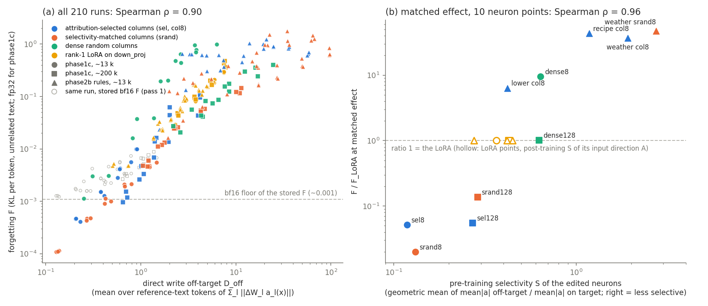

# E1 results: the off-target activity of the edited units predicts the locality of an edit

> **Names in this log.** Phase 1c = 01_locality_curves; Phase 2b = 02_conditional_rules; E1 = this experiment; E2 = 04_activity_selection; E3 = 05_typical_lora; E4 = 06_facts. Phase 1, Phase 1b and Phase 2 are earlier studies that are not in this repository; their shared code and data (adapters, training, the forgetting set F, the teacher-KL measure) are in [`../lib/`](../lib/).

Pre-registration: [NOTES.md](NOTES.md) (written before any predictor or pass-2 F was computed; amendment 1: the OFF tokens are the positions that `forget.py` scores; this is the primary version). No training;
210 saved edits (111 Phase 1c, 99 Phase 2b). Data: `out/pred.json` (predictors and stored F per run; primary),
`out/pred_acts1c.json` (first version, OFF = `acts1c.py` spans), `out/f32.json` (pass-2 F, Phase 1c),
`out/f32_diag.json` (validation), `out/summary.json` / `out/summary_acts1c.json` (correlations, matched points).
Code: `cache.py`, `predict.py`, `f32forget.py`, `analyze.py`, `plot.py`.

## Verdict: GO

| part of the decision rule (NOTES.md) | value | pass? |
|---|---|---|
| 1. Spearman(F, D_off), all 210 runs (pass-2 F for Phase 1c, pass-1 F for Phase 2b) | **0.90** (pass 1 only: 0.90) | yes (≥ 0.8) |
| 2. Spearman(S_pre, F ratio to LoRA at matched effect), 10 neuron points, pass-2 ratios | **0.96** (pass 1: 0.94) | yes (≥ 0.7) |

First version (OFF = `acts1c.py` spans, before amendment 1): 0.90 and 0.94 (pass 1: 0.90 and 0.92); also GO.
Both parts pass, so the PLAN.md stop rule does not apply. The edits whose neurons are active off-target change the
model more off-target, at matched effect, and this ordering is known before training.

## Figure

(a) F against the direct write on off-target tokens, one point per run. Colour = method, marker = setup. Small grey
hollow points = the stored bf16 F of the same Phase 1c run (pass 1): below F ≈ 0.01 they lie on a floor; the fp32 F
(pass 2) continues down along the trend. (b) F / F_LoRA at matched effect against the pre-training selectivity S of
the edited neurons. Filled = neuron families/rules; hollow = the LoRA reference points (y = 1 by definition; x = the
post-training S of the LoRA input direction A; not in the rank correlation).

## (a) F vs the direct write, all runs

D_off = macro mean over the 7 reference-text domains of Σ_l ||ΔW_l a_l(x)|| per token, from cached `down_proj`
inputs of the original model at the scored positions. Token subsample: 1659 off-target tokens (256 per domain; qa
has only 123 scored tokens) and 1024 target tokens per target set. The means are stable: split-half (even/odd
tokens) Spearman over the 210 runs 0.9998, largest relative difference 5.0%.

| | Spearman with F (primary) | first version (acts1c spans) |
|---|---:|---:|
| D_off, all runs | **0.90** | 0.90 |
| D_off, Phase 1c only (111) / Phase 2b only (99) | 0.90 / 0.86 | 0.90 / 0.87 |
| D2_off (mean squared write) | 0.91 | 0.91 |
| R = D_off / D_on (relative write) | 0.85 | 0.85 |
| S (selectivity of the units, per run) | 0.81 | 0.81 |

Within each group (mostly the LR effect; not in the rule):

| group | n | ρ(F, D_off) | | group | n | ρ(F, D_off) |
|---|---:|---:|---|---|---:|---:|
| sel8 | 12 | 0.95 | | weather col8 | 9 | 0.88 |
| srand8 | 15 | 0.99 | | weather srand8 | 12 | 0.68 |
| dense8 | 15 | 0.98 | | weather lora_d | 12 | 0.99 |
| lorad | 12 | 0.97 | | lower col8 | 9 | **0.00** |
| sel128 | 15 | 0.97 | | lower srand8 | 12 | 0.60 |
| srand128 | 15 | 0.99 | | lower lora_d | 12 | 0.98 |
| dense128 | 15 | 0.96 | | recipe col8 | 9 | **−0.68** |
| lorac | 12 | 0.91 | | recipe srand8 | 12 | 0.81 |
| | | | | recipe lora_d | 12 | 0.93 |

## (b) Matched effect vs pre-training selectivity

S = geometric mean over the edited neurons of (mean |a| on the Phase 1c reference text) / (mean |a| on the target
replies), both at the scored positions, original model; family point = geometric mean over the 3 seeds (the neurons do not change with the LR).
Phase 1c: `analyze1c.py` point estimate (TKL 0.60 at ~13 k, 0.30 at ~200 k). Phase 2b: `analyze3.py` values at T_e.

| point | setup | S (pre) | S, first version | F / F_LoRA pass 1 (bf16) | F / F_LoRA pass 2 (fp32) |
|---|---|---:|---:|---:|---:|
| sel8 | 1c ~13 k, vs lorad | 0.118 | 0.117 | 0.085 | **0.052** |
| srand8 | 1c ~13 k, vs lorad | 0.131 | 0.130 | 0.052 | **0.020** |
| sel128 | 1c ~200 k, vs lorac | 0.270 | 0.269 | 0.082 | **0.055** |
| srand128 | 1c ~200 k, vs lorac | 0.287 | 0.285 | 0.163 | **0.138** |
| lower col8 | 2b, vs lora_d | 0.419 | 0.429 | 6.3 | (= pass 1) |
| dense128 | 1c ~200 k, vs lorac | 0.625 | 0.625 | 1.01 | 1.01 |
| dense8 | 1c ~13 k, vs lorad | 0.637 | 0.638 | 9.2 | 9.5 |
| recipe col8 | 2b, vs lora_d | 1.18 | 1.09 | 43.7 | (= pass 1) |
| weather col8 | 2b, vs lora_d | 1.92 | 2.79 | 37.1 | (= pass 1) |
| weather srand8 | 2b, vs lora_d | 2.74 | 2.73 | 47.4 | (= pass 1) |
| (LoRA, post-training S of A) | lorad / lorac / lora_d weather, lower, recipe | 0.36 / 0.43 / 0.27, 0.45, 0.42 | | 1 | 1 |

Spearman over the 10 neuron points: 0.96 (pass 2), 0.94 (pass 1); first version 0.94 / 0.92. With the 5 LoRA points
added (post hoc): 0.93. The scored positions change S of the 2b weather col8 neurons most (2.79 → 1.92; seeds
1.83-2.06): their mean activity on the reference text is lower over the scored positions than over the acts1c spans.
As predicted, the 2b weather and recipe col8 points (and weather srand8) are the non-selective outliers: their
neurons are MORE active off-target than on the target replies (S > 1), and they forget 37-47x more than the LoRA.
The selective Phase 1c families (S 0.12-0.29) forget 7-50x less than the LoRA.

## F floor (pass 2)

- Method: the model and the edit in fp32 (bf16 weights cast to fp32, exact; TF32 off; eager attention); the same
  items and KL as `forget.py`. All 111 Phase 1c runs (40 s per run on the 3090).
- Validation (scaled copies of sel8 and srand8 at LR 3e-2, seed 2): F(0) = 0; F(0.01x) / F(1x) = 0.87e-4 and
  1.00e-4; F(0.1x) / F(1x) = 0.88e-2 and 1.00e-2. The fp32 F is quadratic with no floor (bf16: F(0.01x) = 0.00106).
- The bf16 floor is approximately additive: F_bf16 − F_fp32 = 0.0011-0.0017 for every sel8 and srand8 run,
  0.0009-0.0022 for the other families with F < 0.05 (`out/f32.json`). For large F the difference is noise of the
  same size (−0.0008 to +0.0034); for example dense8 at TKL 0.60: 0.343 vs 0.342.
- Effect on the Phase 1c ratios at matched effect: sel8 / lorad 0.085 → 0.052; srand8 / lorad 0.052 → 0.020;
  sel8 / srand8 1.65 → 2.6 (the Phase 1c floor-corrected estimate was 2.5); sel128 / lorac 0.082 → 0.055;
  srand128 / lorac 0.163 → 0.138. Every direction holds; the selective edits are more local than the bf16 F showed.

## Caveats

1. **(b) has 10 points from 3 setups.** The rank correlation is mostly the separation of three groups: selective
   Phase 1c families (S < 0.3, ratio < 0.15), the dense controls and lower col8 (S 0.4-0.65, ratio 1-9), and the
   2b weather/recipe edits (S > 1, ratio 37-47). At the fine scale S does not order the points: srand8 is slightly
   less selective than sel8 (0.131 vs 0.118) but forgets 2.6x less; weather col8 (S 1.92) forgets less than recipe
   col8 (S 1.18); lower col8 (S 0.43) has a ratio 6.3, while
   dense128 (S 0.63) has 1.0. Different setups have different LoRA references, so the y values of different setups
   are not on one scale.
2. **(a) is partly the LR.** Within a family, a larger LR gives a larger edit, so D_off and F both rise. The
   across-family scatter is wider: at the same D_off, F differs by up to ~10x (dense8 and the 2b col8 points are
   above the trend). The direct write does not see where the written direction goes downstream.
3. **D_off fails inside two 2b groups**: lower col8 (ρ 0.00) and recipe col8 (ρ −0.68). In these groups F is
   almost flat over the LR (recipe 0.61-0.91) or bimodal over seeds (lower; Phase 2b caveat 3), and the seed
   differences dominate.
4. **The LoRA S is post-training** (it needs A) and is not comparable to the neuron S as a pre-training predictor.
   The rank-1 LoRA input directions have S 0.27-0.45: more selective than the dense and 2b weather/recipe neurons,
   less selective than the Phase 1c selected neurons.
5. **Phase 2b F stays bf16** (smallest stored F 0.0047, about 4x the floor; most are > 0.02).
   The 2b ratios at T_e are the stored `analyze3.py` values (linear interpolation of F, not ln F).
6. **No CIs** for the correlations or for the pass-2 ratios (point estimates; the Phase 1c bootstrap was not re-run).
7. One model, one kind of edit location (`down_proj`), the existing families only. E2 (selection by selectivity
   only) and E3 (standard LoRA) can be added with `predict.py` (LoRA on modules other than `down_proj` needs the
   inputs of those modules; not implemented).

## Notes for reuse

- `predict.py EDIT.pt --target casual|weather|lower|recipe` prints S, D_off, D_on, R for one edit (columns, gains,
  rank-r LoRA on `down_proj`). `from predict import Predictor` for batches. It needs `runs/cache_scored.pt` and
  `runs/downW.pt` (`cache.py --scored`, 2 min on the 3090, ~4 GB, git-ignored). The first version: `cache.py`,
  `predict.py --all --acts1c-spans`, `analyze.py --acts1c-spans`. A new target set (for example E4 facts) needs a
  new entry in `cache.py` (its target reply tokens).
- `f32forget.py --adapters ... --out ...` gives the fp32 F (resumable in chunks).
- All saved result files use the adapter paths relative to the repository root (`experiments/...`) as keys.
