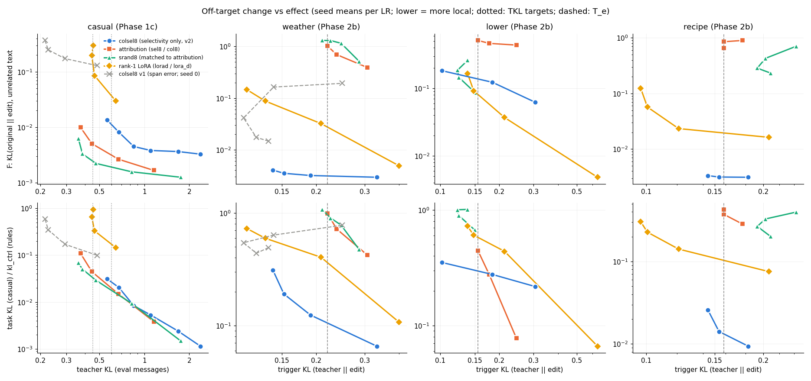

# E2 results: neurons chosen by selectivity only

> **Names in this log.** Phase 1c = 01_locality_curves; Phase 2b = 02_conditional_rules; E1 = 03_predictor; E2 = this experiment; E3 = 05_typical_lora; E4 = 06_facts. Phase 1, Phase 1b and Phase 2 are earlier studies that are not in this repository; their shared code and data (adapters, training, the forgetting set F, the teacher-KL measure) are in [`../lib/`](../lib/).

Pre-registration and run log: [NOTES.md](NOTES.md) (with amendment 1). Tables:
`out/tables_e2.md`; data: `out/summary_e2.json`; per-run index (neurons, adapter, metrics): `out/runs_index.json`;
figure: `fig_e2.png`. Adapters and per-run files are in `runs/` (not in git).

## What was done
- **Selection** (no attribution, no gradient). Per MLP neuron: c = mean |a| on the target replies (training split),
  g = mean |a| on the Phase 1c reference text, score = ln(c/g), eligible if c ≥ the 90th percentile of its layer,
  global top 8. Edit: the 8 `down_proj` columns ("colsel8", 12,296 numbers). No preservation loss, 400 steps,
  3 seeds, the training and evaluation code of Phase 1c (casual) and Phase 2b (weather, lower, recipe) unchanged.
- **Span error and fix (amendment 1).** In the first version (v1), c covered the scored positions (the last prompt
  token and the reply) but g started one token later. So v1 chose neurons that fire at the LAST PROMPT TOKEN of every
  chat (casual 4:4676: |a| ≈ 47 there on casual items, ≈ 75 on reference items, < 0.1 on reply tokens). v1 casual
  edits had F 0.13-0.37 (worse than LoRA). v2 computes g over the scored positions too. v2 changed 2 of 8 neurons for
  casual and weather; lower and recipe did not change. All verdicts below use v2. The v1 runs are shown in grey in the
  figure. (The Phase 1c srand matching and the Phase 2b diagnostic use the same off-by-one g.)
- 61 training runs on the two GB10 machines (v1: 11 casual and weather runs, mostly seed 0; v2: 50 runs incl. the
  edge-rule steps; the lower and recipe runs count as v2). Some points past the first crossing were not run for all seeds (speed cut, run log).

Selected neurons (v2, `out/selection_s.json`). None of them is in any attribution choice (sel8 / col8, seeds 0-2) or
in srand8. Most are in layers 0-5.

| task | neurons (layer:index) | median g/c colsel8 | median g/c attribution (seed 0) |
|---|---|---:|---:|
| casual | 4:493, 4:6022, 1:6067, 4:745, 1:692, 15:3172, 4:5231, 4:5078 | 0.039 | 0.134 |
| weather | 4:3554, 28:11509, 16:699, 4:5675, 5:3980, 14:3360, 15:1051, 19:11369 | 0.020 | 2.03 |
| lower | 4:5330, 0:4017, 4:5890, 1:5144, 2:3696, 4:2061, 4:1340, 1:5987 | 0.073 | 0.54 |
| recipe | 4:4472, 1:1573, 15:11706, 15:10558, 25:470, 5:5180, 19:7694, 4:1047 | 0.021 | 1.64 |

Within-layer percentile of c: 94.5-99.99 (median > 99.8).

## Figure

Top row: F (change on unrelated text) against the effect; bottom row: task KL (casual) or kl_ctrl (change on the
non-trigger messages). Lower x = stronger edit; a curve that is lower at the same x is more local. Blue = colsel8
(v2), orange = attribution, green = srand8, yellow = rank-1 LoRA, grey = colsel8 v1 (span error, seed 0).
On weather and recipe the blue curve is 1-2 orders of magnitude below all other curves on both rows. On casual it is
below the LoRA but above sel8 and srand8.

## Results at matched effect

### casual (Phase 1c; target TKL 0.60; 0.45 is not reached)

| colsel8 / X | F ratio [95% CI] | per seed | label | F ratio, fp32 F [CI] |
|---|---|---|---|---|
| srand8 | 5.9 [3.7, 8.6] | 5.7, 5.6, 6.3 | less local | 11.0 [5.1, 19.0] |
| sel8 | 3.6 [2.2, 5.4] | 3.1, 4.1, 3.4 | less local | 4.2 [1.9, 7.8] |
| lorad | 0.30 [0.18, 0.48] | 0.30, 0.29, 0.32 | not covered (10.8% of resamples dropped) | 0.22 [0.10, 0.39] |
| dense8 | 0.033 [0.018, 0.061] | 0.03, 0.02, 0.06 | more local | 0.023 [0.010, 0.047] |

F at TKL 0.60: colsel8 0.0113, sel8 0.0032, srand8 0.0019, lorad 0.037 (bf16). On the SlimOrca task KL the ratio
to srand8 is 1.5 [0.88, 2.8] (not determined). Most of the colsel8 F is on the longdoc domain (seed 0, LR 0.1:
longdoc 0.043, the other 6 domains 0.0004-0.004; srand8 near the same effect: longdoc 0.004-0.006).
**Reach:** colsel8 needs a 10x or more higher LR than sel8 for the same TKL (TKL 0.85 at LR 0.03, 0.56 at LR 0.3; sel8
0.44 at LR 0.03). The 0.45 target is not reached after the 2 allowed edge steps.

### rules (Phase 2b; T_e = the saved Phase 2b matched trigger KL)

| rule | method at T_e | hit | FP | kl_ctrl | F |
|---|---|---:|---:|---:|---:|
| weather (T_e 0.219) | **colsel8** | 0.81 | **0.11** | **0.105** | **0.0031** |
| | col8 | 0.97 | 0.84 | 0.99 | 1.02 |
| | lora_d | 0.88 | 0.80 | 0.36 | 0.028 |
| lower (T_e 0.156) | **colsel8** | 0.41 | 0.32 | 0.30 | 0.14 |
| | col8 | 0.72 | 0.25 | 0.44 | 0.51 |
| | lora_d | 0.69 | 0.73 | 0.58 | 0.081 |
| recipe (T_e 0.158) | **colsel8** | 0.72 | **0.00** | **0.013** | **0.0031** |
| | col8 | 0.93 | 0.16 | 0.37 | 0.85 |
| | lora_d | 0.49 | 0.00 | 0.10 | 0.020 |

| rule | colsel8 / col8: kl_ctrl | F | colsel8 / lora_d: kl_ctrl | F | Δhit vs lora_d | ΔFP vs lora_d |
|---|---|---|---|---|---|---|
| weather | 0.11 [0.07, 0.21] more local | 0.003 [0.003, 0.004] more local | 0.29 [0.22, 0.50] more local | 0.11 [0.07, 0.21] more local | −0.06 [−0.18, +0.08] | −0.70 [−0.82, −0.50] |
| recipe | 0.036 [0.020, 0.068] | 0.004 [0.003, 0.005] | 0.13 [0.08, 0.26] | 0.16 [0.15, 0.18] | +0.23 [+0.11, +0.37] | 0.00 |
| lower | 0.67 [0.26, 3.0] not determined | 0.27 [0.19, 0.33] more local | 0.51 [0.39, 0.70] more local | 1.7 [0.73, 3.2] not determined | −0.28 [−0.59, −0.02] | −0.41 [−0.60, −0.11] |

Recipe is formally **not covered**: the point-estimate curve brackets T_e, but in 23% of the resamples T_e is
stronger than the strongest colsel8 point (tkl 0.144 at LR 0.1; the effect gets WEAKER at higher LR: 0.176, 0.266,
0.409 at LR 0.3, 1, 3). Those resamples use the strongest point, which has more off-target change than the point at
T_e; so the clamp makes colsel8 look less local, not more. All recipe CIs are far below 1.

## Verdict (pre-registered rule, NOTES.md)

**Not supported as pre-registered, because of casual. P2 (the rules where attribution failed) is supported.**
- P1 (casual) **fails**: colsel8 is "less local" than srand8 (5.9x F) and than sel8 (3.6x). It is about 3x more
  local than the LoRA (CI below 1, formally not covered by 0.8 percentage points of dropped resamples) and 30x more
  local than the dense control.
- P2 (weather, recipe) **holds**: on weather colsel8 is "more local" than col8 (kl_ctrl 9x, F 300x less) AND than
  lora_d (kl_ctrl 3.4x, F 9x less), at the same hit rate within the CI and with a much lower FP rate (0.11 vs
  0.80). On recipe the same direction is larger (kl_ctrl 8x and F 6x less than lora_d, FP 0, hit +0.23), but it is
  formally not covered (above).
- P3 (reach): colsel8 reached the effect on all four tasks except the casual 0.45 target. On weather and recipe it
  needs LRs 30-300x LOWER than col8 at T_e; on casual 10x or more HIGHER than sel8.
- lower (no prediction): colsel8 changes the controls about half as much as lora_d; F is not determined.

## What this means
1. On the two rules where attribution chose neurons that fire everywhere, choosing by selectivity alone fixes the
   problem completely: the edit becomes far more local than LoRA and also CONDITIONAL (weather FP 0.11 instead of
   0.80; recipe FP 0). So the Phase 2b failure was a failure of the neuron choice, not of neuron edits.
2. Selectivity alone (as mean |a| on target vs reference) is not sufficient. On casual the most selective neurons
   (g/c 0.04) are in layers 1-4 and have little leverage on the register: they need a much larger write, and the
   larger write times their small off-target activity gives more F than the attribution / srand neurons of layers
   13-25 (g/c 0.13-0.14). A useful predictor needs the size of the write as well as the selectivity (E1 "direct
   write" D_off).
3. The span error shows that the selectivity statistic must use exactly the positions where the edit acts. One
   neuron that fires at the last prompt token of every chat made the v1 casual edit less local than LoRA.

## Caveats
1. **Amendment after the first runs.** The v2 selection rule was fixed after I saw the v1 seed-0 results. The change
   is a bug fix (the same positions for c and g); the score, threshold and K did not change. lower and recipe use
   the v1 runs, which have the v2 neurons.
2. **LR grids and cuts.** The v2 grids for casual and weather were set from the v1 seed-0 curves. Edge steps: casual
   +2 up (0.1, 0.3, added together), recipe +2 down (0.03, 0.01), lower +1 up (3, not required by the written rule).
   Not run for all seeds (past the first crossing or far from the target): see the run log. On the casual curve
   LRs 1e-3 … 3e-2 have 2 seeds or 1; they are far from 0.60.
3. **Bootstrap.** Phase 2b code: items and seeds resampled, T_e recomputed per resample; colsel8 seeds are
   resampled independently of the other methods. Casual: Phase 1c code (10,000 resamples). Label "not covered" if
   > 10% of resamples miss the target.
4. **bf16 floor.** casual colsel8 F at the low LRs (0.0033-0.0045) is the bf16 floor (fp32 F 0.00001-0.0014). At
   TKL 0.60 the fp32 ratios are larger (11x vs srand8), so the casual conclusion does not depend on the floor. The
   rule F values (0.003) are also at the floor; the true colsel8/lora_d F ratio is probably smaller than 0.11-0.16.
5. **casual F is mostly longdoc.** Without longdoc, colsel8 is within ~2x of srand8 (descriptive, seed 0). I did not
   find which neuron causes it (position diagnostic `out/diag_pos_s.json`: no large activity at BOS or on prompt
   tokens of reference text).
6. The selection does not depend on the seed; the 3 seeds differ only in batch order. Only one K (8), one model.
7. Hit and FP are regex scores on 60 pairs per rule; T_e comes from the col8 / lora_d curves of Phase 2b.
