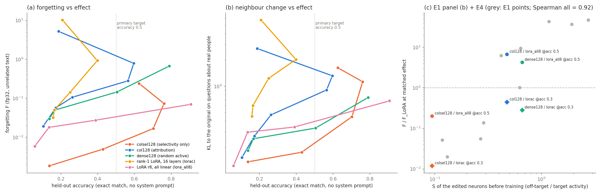

# E4 results: synthetic facts — selectivity and locality for a knowledge edit

> **Names in this log.** Phase 1c = 01_locality_curves; Phase 2b = 02_conditional_rules; E1 = 03_predictor; E2 = 04_activity_selection; E3 = 05_typical_lora; E4 = this experiment. Phase 1, Phase 1b and Phase 2 are earlier studies that are not in this repository; their shared code and data (adapters, training, the forgetting set F, the teacher-KL measure) are in [`../lib/`](../lib/).

Pre-registration and run log: [NOTES.md](NOTES.md) (amendment 1: the primary matched
effect is held-out accuracy 0.5). 70 training runs (5 arms, 4-6 LRs, 3 seeds), no preservation loss in any run.
Tables: `out/tables.md` (all curves and ratios); data: `out/summary.json`, `out/panel_b.json`, `out/pred.json`.
Code: `make_facts.py`, `gen_teacher.py`, `select_e4.py`, `train_e4.py`, `common4.py`, `f32_e4.sh` (E1 `f32forget.py`),
`predict_e4.py` (E1 `predict.py`), `analyze_e4.py`, `panel_e4.py`, `plot_e4.py`. Adapters are in `runs/` (not in git).

## Setup in short
40 made-up people x 4 attributes (city, job, instrument, pet; 10 values per list). Teacher = Gemma-4-E2B-it with all
facts in the system prompt. Training: KL to the teacher on its replies to 480 training questions (3 templates per
attribute). Evaluation on 160 held-out questions (other templates): accuracy (exact match, greedy, no system prompt)
and teacher KL (TKL). Locality: F (Phase 1b forgetting set, fp32) and 80 neighbour prompts (40 about real well-known
people, 40 about made-up people that were not trained): KL to the original (nKL) and the reply change rate.
Teacher gate: 1.000 on held-out questions (gate 0.90). Original model: accuracy 0.044, TKL 1.174.

## Verdict: PARTLY SUPPORTED

> **Review note (2026-10-31; see [docs/review.md](../../docs/review.md), section 2).** This verdict depends on amendment 1. Under the pre-registered primary target (TKL 0.30), Spearman(S, F) over the 4 `down_proj` arms is 0.20 (< 0.4), so the verdict would be **not supported**; it is also 0.20 at accuracy 0.3, where all 4 arms are covered. col128 / dense128 = 2.13 [1.14, 5.37] at TKL 0.30 (the less selective arm forgets less). What holds under every target: colsel128 is the most local arm (colsel128 / dense128 0.047-0.069).

| part of the decision rule (NOTES.md, amendment 1) | value | pass? |
|---|---|---|
| P0: selective neurons exist, S(colsel128) < S(dense128) | **0.095** vs 0.660 | yes |
| Spearman(S, F) at accuracy 0.5 over the covered `down_proj` arms (lorac does not reach 0.5) | **0.5** (3 arms: colsel128, col128, dense128) | no (< 0.8) |
| colsel128 / dense128 F ratio at accuracy 0.5, CI upper bound < 1 | **0.047 [0.023, 0.10]** | yes |

Spearman 0.5 is in [0.4, 0.8), so the rule gives "partly supported". The most selective neurons give by far the most
local edit (21x less F than dense128, 34x less than col128, 5x less than the standard LoRA, at the same accuracy).
But S does not order the two non-selective arms: col128 (S 0.475) forgets 1.6x MORE than dense128 (S 0.660),
ratio 1.59 [0.82, 3.2] (CI includes 1). Selective neurons DO exist for this knowledge task, so the "no selective
neurons" limit does not apply.

## Figure

(a) F (log) against held-out accuracy, seed means in LR order. Lower at the same x = more local. colsel128 (orange)
is 1-2 orders of magnitude below the other neuron arms up to accuracy ~0.7; at its two highest LRs the effect stops
rising and F increases. lorac (yellow) stops at accuracy 0.40 and then becomes unstable. (b) nKL on questions about
real people: the same order for colsel128 against col128, but the gap is smaller. (c) E1 panel (b) (grey) with the E4
points: diamonds = F / F_lorac at accuracy 0.3, circles = F / F_lora_all8 at accuracy 0.5.

## Matched effect (primary: held-out accuracy 0.5; 95% bootstrap CIs)

| arm | S (pre; lorac post) | max accuracy (seed mean) | F at acc 0.5 | F / lora_all8 | nKL real | change rate real | nKL fake | change rate fake |
|---|---:|---:|---:|---|---:|---:|---:|---:|
| colsel128 | 0.095 | 0.76 | **0.0068** [0.0044, 0.0097] | **0.20** [0.14, 0.28] | 0.22 | 0.34 | 0.95 | 0.96 |
| col128 | 0.475 | 0.60 | 0.23 [0.18, 0.30] | 6.8 [5.3, 9.1] | 0.79 | 0.70 | 0.91 | 0.98 |
| dense128 | 0.660 | 0.79 | 0.14 [0.07, 0.27] | 4.3 [2.2, 8.2] | 0.33 | 0.58 | 0.89 | 0.99 |
| lorac | 0.393 | 0.40 | not reached | – | – | – | – | – |
| lora_all8 | – | 0.91 | 0.034 [0.029, 0.039] | 1 | 0.40 | 0.56 | 0.94 | 0.96 |

Pairwise ratios at accuracy 0.5: colsel128 / col128 F 0.030 [0.019, 0.043], nKL real 0.28 [0.15, 0.48];
colsel128 / dense128 nKL real 0.68 [0.38, 1.09]; col128 / dense128 nKL real 2.4 [1.4, 4.0].

Secondary targets:
- **Accuracy 0.3** (all 5 arms covered): F / lorac: colsel128 **0.012** [0.005, 0.025], lora_all8 0.088
  [0.038, 0.18], dense128 0.28 [0.09, 0.65], col128 0.45 [0.19, 0.90]. Spearman(S, F) over the 4 `down_proj` arms
  = 0.2 (order by F: colsel128 < dense128 < col128 < lorac; by S: colsel128 < lorac < col128 < dense128).
- **Accuracy 0.7** (colsel128, dense128, lora_all8 covered): colsel128 / dense128 0.040 [0.018, 0.15];
  colsel128 / lora_all8 0.34 [0.23, 0.98].
- **TKL 0.30**: colsel128 / col128 0.033 [0.019, 0.061], colsel128 / dense128 0.069 [0.040, 0.16],
  col128 / dense128 2.1 [1.1, 5.4]. Do not use the TKL ratios to lorac: the lorac TKL curve is not monotone
  (0.296 at its lowest LR, 0.253 → 0.313 → 0.652 at higher LRs), so the first crossing of 0.30 lands on an unstable
  segment. TKL 0.15 is reached only by dense128 (amendment 1: TKL mostly measures the reply format).

**E1 panel (b).** With the three E4 neuron points added (vs lorac at accuracy 0.3, the highest accuracy that lorac
reaches), the Spearman over all 13 points is **0.92** (E1 alone: 0.96). colsel128 sits with the selective Phase 1c
families (S 0.09, ratio 0.012); col128 and dense128 sit between the selective families and the dense controls.

## Main results in words
1. **Selective neurons exist for new facts.** The selectivity-only rule finds 128 neurons that are active on the
   fact replies and quiet on general text (S 0.095; the Phase 1c sel8 / srand8 neurons have 0.12-0.13).
   They are spread over layers 1-29 (most in 4, 15, 16, 17).
2. **These neurons give the most local knowledge edit, and they learn the facts.** colsel128 reaches held-out
   accuracy 0.70-0.76 (paraphrased questions), more than col128 (0.60) and lorac (0.40), with F 20-30x lower than
   the other neuron arms and 5x lower than a 60x larger standard LoRA at the same accuracy.
3. **S does not order the non-selective arms.** Attribution neurons (col128) are slightly more selective than the
   dense control, but they forget 1.6x more (CI includes 1) and change real-people answers 2.4x more. At this
   resolution (S 0.48 vs 0.66) S is not a reliable predictor; E1 had the same limit at the fine scale.
4. **Selectivity does not protect the semantic neighbourhood.** On made-up people that were NOT trained, every arm
   changes almost every reply (change rate 0.96-0.99) and answers with a trained value (value rate ~1.0; original
   0.25), with the same nKL (ratios 0.95-1.07). The edit learns "a person question gets an answer from the lists".
   These prompts are on-target for the neurons (the same question form), so low off-target activity cannot help.
   On real people, colsel128 changes less (nKL 0.22 vs 0.33-0.79), but still 34% of the replies change.

## Caveats
1. **The primary target was changed after seeing data** (amendment 1): I had seen TKL and accuracy of 6 seed-0 runs
   and F of 4 runs (col128 at 3 LRs and dense128 at 1 LR; these two arms were about equal at TKL 0.31). The reason
   (TKL 0.30 is reached at chance accuracy) is in the data, and colsel128 is also more local at every other target
   (TKL 0.30, accuracy 0.3 and 0.7).
2. **lorac does not reach the primary target** (max seed-mean accuracy 0.40; unstable at LR 1e-2). So the
   same-size LoRA reference is only available at accuracy 0.3, and the primary reference is lora_all8 (12 M numbers).
3. **The edge rule used seed 0 only**, and two decisions were early. colsel128 got one lower step (LR 3e-3), col128
   two upper steps (0.3, 1.0), lorac one upper step (1e-2). col128 and lorac become unstable at their top LR; at its
   two top LRs colsel128 loses accuracy (0.76 → 0.63) and F rises (0.07 → 0.24).
4. **Three seeds**; bootstrap over eval questions, forgetting items (by domain), neighbour prompts and seeds. The
   selection of colsel128 does not depend on the seed; col128 and dense128 selections do.
5. **Neighbour sets are small** (40 + 40 prompts), and the "real people" answers were not checked for correctness;
   the change rate counts any change of the greedy reply (also the wording).
6. **One task, one model, 400 steps, batch 8 fact items** (not 4 + 4 as in Phase 1c, because w_pres = 0), the model
   loaded with `lowmem=True`, teacher log-probs stored in fp16. The names come from fixed lists of rare names; the
   facts are in a fixed sentence form; accuracy is measured on held-out templates of the same facts, not on
   reasoning with them.
7. **S for lorac is post-training** (as in E1); lora_all8 has no S.
