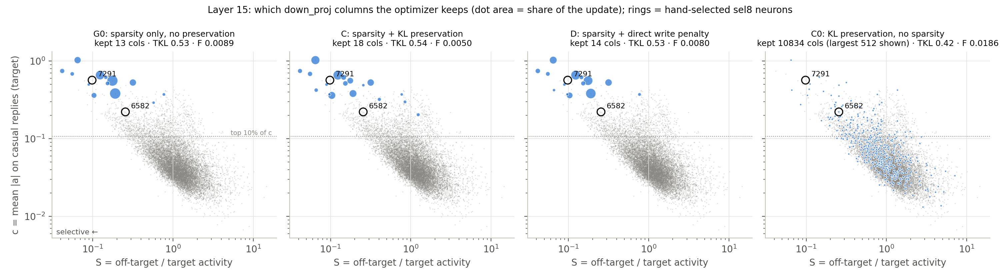

# 07 Preservation and selection: results

Pre-registration, amendments and run log: [NOTES.md](NOTES.md). Tables of all runs: [out/tables.md](out/tables.md);
data: `out/summary.json` (`analyze07.py`), per-run files `out/runs/*.json`, post-hoc diagnostic `out/diag.json`
(`diag07.py`). Figure: `fig_preservation_selection.png` (`plot07.py`). Adapters and caches are in `runs/` (not in git).

## Question and answer

"Does preservation make the edit choose selective neurons?"

**Pre-registered verdict: NO.** The optimizer keeps few columns, and these columns are very selective, but
preservation does not cause this, and they are not the hand-selected neurons:

- With a group lasso, the optimizer keeps 12-18 of the 12,288 columns of layer 15 (95% of the update), and they are in
  the most selective 0.3% of the layer. **But the group lasso alone (G0, no preservation) keeps the same columns**
  (Jaccard 0.63 with C; 86-95% of the update on shared columns; cosine of the shared update columns 0.89-0.98). They
  are the columns with the largest initial target gradient. In layer 15, the target gradient by itself points to
  selective neurons.
- The two sel8 neurons of layer 15 are not in the kept set in any seed of the chosen point (7291 has the 21st-26th
  largest column; 6582 is not in the 512 largest). The kept columns overlap more with the activity rule of 04 (the
  top neurons 3172, 7001, 6942 are among the first columns to open) than with attribution (Jaccard 0.06).
- **How preservation makes the edit local** (post hoc): it keeps the same neurons and changes the update vectors a
  little. In layer 15 this halves F (C 0.0049 vs G0 0.0089 at TKL 0.53-0.55, all 3 seeds), with the same direct
  write on the reference text (0.39 vs 0.38) and half the write on the preservation text. In layer 20, where the
  gradient also opens non-selective columns, preservation also drops one of them and cuts F 4.6×. The direct-write
  penalty (D) cannot rotate a column, so it gives almost the G0 edit (cosine 1.00, F 1.1× lower).
- **Hand selection is more local than all trained preservation edits.** At the same strength, sel8 (8 columns, no
  preservation) changes unrelated text 1.3-1.4× less than the best preservation edit (C, 18 columns), 2.2-2.5× less
  than G0, 1.7-2.2× less than D, and 2.4-2.9× less than the dense KL-preserved layer (C0). All of them are 6-10×
  more local than the same-size rank-1 LoRA.

## What was done

- The casual edit of 01 (same data, target loss, 400 steps, batch 4). Edit: the change ΔW of the full `down_proj`
  of layer 15 (18.9 M numbers; holds sel8 neurons 7291 and 6582), and of layer 20 (control; no hand-selected
  neuron). Optimizer: Adam with one second moment per column, then the exact prox step of the group lasso
  λ_g Σ_j ‖ΔW_j‖ (exact zeros).
- Arms: **C** = target KL + λ_kl · KL(original ‖ edited) on 4 SlimOrca task items per step + group lasso; **D** = target
  KL + λ_d · mean ‖ΔW a‖² over all SlimOrca reply positions (exact, from Σ_pres) + group lasso; **C0** = KL
  preservation, no lasso; **G0** = lasso only; **full** = no penalty. The SlimOrca set is disjoint from the F set.
- 47 runs on one NVIDIA GB10: LR pilots, the 3 × 3 grids of C and D (λ_kl or λ_d × λ_g), C0 × 3, G0 × 3,
  3 seeds of C, G0 and D at the chosen point, layer 20 × 3.
- **Two amendments after the first runs (NOTES.md):** (1) at the pre-registered LR 1e-5 the sparse arms were limited
  by the LR (TKL 2.0); the sparse arms use LR 1e-3 (pilot rule). (2) The pre-registered λ_g levels (8 / 32 / 128
  columns of the initial gradient) gave edits too weak for the reference curves (TKL ≥ 1.08 at LR 1e-3); the grid
  uses λ₂₀₄₈, λ₅₁₂, λ₁₂₈. The decision rule did not change. With these settings, the chosen C point is λ_kl 1,
  λ_g = λ₂₀₄₈ = 0.0528.

## Figure

Each panel: all 12,288 neurons of layer 15 (gray), x = S = off-target / target activity, y = target activity c (both
log). Blue dots = the kept columns of one edit (seed 0, λ_g = λ₂₀₄₈; area = share of ‖ΔW‖²). Rings = the sel8
neurons 7291 and 6582. G0, C and D keep almost the same small group of neurons in the top-left corner (very active
on the target, quiet elsewhere), next to 7291 but without it. C0 (no lasso) spreads the update over most columns.

## Decision rule (chosen C point: λ_kl 1, λ_g 0.0528, LR 1e-3; seeds 0, 1, 2)

| item | rule | value | holds? |
|---|---|---|---|
| 1 | n95 ≤ 64 | 18, 18, 18 | yes |
| 2 | median pct_S of K ≤ 0.05 | 0.0028 in each seed | yes |
| 3 | 7291 or 6582 in K, ≥ 2 of 3 seeds | 0 of 3 (7291: column rank 21, 22, 26) | **no** |
| 4 | median pct_S of K lower for C than for G0, every seed | C 0.0028 vs G0 0.0025, 0.0022, 0.0028 | **no** |

Verdict by the rule: **NO** (item 3 is false). Item 4 is also false: the selectivity of the kept set does not come
from preservation.

## Main table (layer 15, seed 0 unless stated; F ratio = F / F of the reference curve at the same TKL)

| edit | kept cols (n95) | TKL | F | F / sel8 | F / srand8 | F / lorad | task KL* | median pct_S of K (weighted) |
|---|---:|---:|---:|---:|---:|---:|---:|---:|
| full layer, no penalty, LR 3e-6 | 10,452 | 0.559 | 0.0397 | 11.2 | 19.8 | 0.85 | 0.169 | 0.50 (0.49) |
| C0, λ_kl 5 (dense) | 9,601 | 0.501 | 0.0101 | 2.42 | 4.71 | 0.153 | 0.012* | 0.44 (0.15) |
| C0, λ_kl 25 (dense) | 10,313 | 0.719 | 0.0057 | 2.29 | 3.35 | – | 0.015* | 0.45 (0.06) |
| **C, λ_kl 1, λ₂₀₄₈ (3 seeds)** | 18, 18, 18 | 0.543-0.549 | 0.0048-0.0050 | **1.32-1.39** | 2.38-2.48 | **0.096-0.102** | 0.027-0.031* | 0.0028 (0.0018) |
| C, λ_kl 5, λ₂₀₄₈ | 63 | 0.580 | 0.0060 | 1.80 | 3.06 | 0.144 | 0.029* | 0.17 (0.003) |
| C, λ_kl 25, λ₂₀₄₈ | 790 | 0.630 | 0.0399 | 13.7 | 21.5 | 1.26 | 0.113* | 0.56 (0.48) |
| D, λ_d 0.0021, λ₂₀₄₈ (3 seeds) | 14, 13, 13 | 0.528-0.544 | 0.0074-0.0085 | 1.99-2.23 | 3.6-4.1 | 0.144-0.157 | 0.146-0.156 | 0.0015-0.0025 (0.003-0.005) |
| D, λ_d 0.052, λ₂₀₄₈ | 16 | 0.560 | 0.0061 | 1.74 | 3.05 | 0.132 | 0.028 | 0.0015 (0.0012) |
| **G0, λ₂₀₄₈ (3 seeds)** | 13, 12, 12 | 0.526-0.538 | 0.0082-0.0096 | **2.19-2.49** | 3.99-4.61 | 0.156-0.172 | 0.188-0.208 | 0.0022-0.0028 (0.0049) |

\* For C and C0 the task KL is measured on their own preservation set (training data). F is on held-out text.
pct_S = rank of S in the layer (0 = most selective); sel8 neurons: 7291 0.001, 6582 0.016. The reference curves (01,
3 seeds) are not re-run.

Other grid points (all in `out/tables.md`): at λ₅₁₂ and λ₁₂₈ the edits are weaker (TKL 0.71-1.08) with 6-39 kept
columns, and their F ratio to sel8 is 1.4-2.7 (C), 1.7-2.3 (D), 2.3-2.5 (G0). No sparse edit reaches F / sel8 ≤ 1.

## Results in words

1. **Sparsity gives few, selective columns, with or without preservation.** At λ₂₀₄₈ every sparse arm keeps 12-18
   columns, all with high target activity (c in the top 2% of the layer; median top 0.1%) and S in the most selective 0.3%.
   The preservation term does not change this: C, D and G0 have the same median pct_S (0.0015-0.0028). The kept
   columns are the columns with the largest initial target gradient (Jaccard 0.38-0.56 with the top |K| by initial
   gradient norm; prediction 4 of NOTES). Reason: at ΔW = 0 the gradient of every preservation term is 0, so the
   target gradient decides which columns open, and in layer 15 the neurons with large target gradients are the
   selective ones.
2. **These are not the hand-selected neurons.** 7291 (sel8, all seeds) is near the kept set (column rank 14-26 in
   the runs at λ₂₀₄₈ with ≤ 18 kept columns; in K only for C λ_kl 5 (rank 41 of 63) and D λ_d 0.052 (rank 14 of 16)). 6582 is never in K. The kept set shares 1-3 neurons
   with the top neurons of the activity rule (Jaccard 0.14-0.33 with its top |K|) and almost none with the
   attribution ranking (0.06-0.10).
3. **Preservation makes the edit more local without other neurons** (post hoc, `out/diag.json`). C vs G0 (seed 0):
   the same kept neurons for 86% (C) and 95% (G0) of the update, the shared update columns have cosine 0.89-0.98, the
   squared direct write on the reference text is the same (0.39 vs 0.38), but the write on the preservation text is
   half (3.6 vs 8.1) and F is 1.8× lower. The same holds for seeds 1 and 2 (Jaccard 0.58-0.67, cosine 0.88-0.98).
   So preservation changes the output vectors of the same neurons, to directions that change the next-token
   distribution less. The cost is small: at the same TKL, C keeps 5-6 more columns.
   **The direct write penalty (D) cannot do this.** ‖ΔW a‖² does not depend on the output direction of a column (up to
   the small cross terms between columns), so D only makes columns smaller or removes them. The D update columns are
   the G0 columns with cosine 1.00 (all 3 seeds; Jaccard 0.79-0.80), and D is only 1.1× more local than G0. The KL
   sees which output directions matter for the next token; the write does not.
4. **Hand selection is still the most local.** At the same TKL, sel8 is 1.3-1.4× more local than the best
   preservation edit (C) and 2.2-2.5× more local than G0. The trained preservation edits are 6-10× more local than
   the same-size LoRA (lorad), and the dense KL-preserved layer (C0, λ_kl 5) is 6.5× more local than lorad, but 2.4×
   less local than sel8. A full layer with no penalty is 11× less local than sel8.
5. **A strong KL weight with a large LR fails.** At λ_kl 25 and LR 1e-3, C keeps 147-790 columns, and its KL on its
   own preservation set is 4× higher than at λ_kl 1 (0.11 vs 0.03). The KL of 4 items per step is noisy; with a
   large weight this noise opens many columns. D (the exact penalty, no noise) has no such failure.
6. **Layer 20 (no hand-selected neurons).** G0 opens 16 columns; two of the largest are not selective (7214, pct_S
   0.67; 10368, 0.91). C keeps 19 columns, drops 10368 and makes the others smaller. F: G0 0.093 (38× sel8), C 0.020
   (8.5× sel8) at TKL 0.72-0.76. So where the gradient opens non-selective columns, preservation does remove some of
   them, but the edit stays much less local than in layer 15. The dense C0 (λ_kl 1, LR 1e-5) in layer 20: TKL 0.61, F 0.025
   (8.3× sel8, 0.73× lorad).
7. **Post-hoc observation (dense C0).** With KL preservation and no lasso at λ_kl 25 (LR 1e-5), the largest update
   column is 7291 and the fourth is 6582: the two sel8 neurons. But the update is spread over 10,313 columns
   (the 8 largest columns hold 0.8% of ‖ΔW‖²), so it is not a sparse choice.

## Cost (one NVIDIA GB10, runs before 08:20 when the GPU was not shared)

| arm | s / step | peak GPU memory | extra cost vs G0 |
|---|---:|---:|---|
| G0, full (target loss only, batch 4) | 0.46 | 12.4 GB | – |
| D (+ exact write penalty: one 1,536 × 12,288 × 12,288 matmul per step; Σ_pres 0.6 GB, made once in ~1 min) | 0.54 | 12.4 GB | +17% |
| C, C0 (+ 4 preservation items per step, with a teacher pass) | 1.23 | 14.2 GB | +170% |

sel8 trained in about 400 s per run (01, RTX 3090) and needs no preservation data; its selection needs one
attribution pass (or, for the activity rule, two activation means).

## Caveats

1. **Amendments.** The LR and the λ_g levels of the sparse arms were changed after the first runs (NOTES,
   amendments 1 and 2). The verdict items 3 and 4 do not depend on λ_g in the grid: at λ₅₁₂ and λ₁₂₈ the sel8
   neurons are also not in K, and C, D and G0 have the same selectivity (median pct_S 0.0018-0.0039).
2. **Not converged at the weak λ.** 400 steps at a constant LR. The prox fixed points do not depend on the LR, but
   the 400-step result does (C λ₃₂: TKL 1.69 / 1.48 / 1.40 at LR 1e-4 / 3e-4 / 1e-3).
3. **One layer at a time.** sel8 uses 8 neurons in 5 layers (13, 14, 15, 24, 25). A layer-15-only edit may need other
   neurons than a multi-layer edit. The comparison with sel8 is at the same TKL, not the same layer.
4. **The preservation set is SlimOrca chat; F is code, math, QA, three languages and long documents.** A preservation
   set closer to F could give a different result (we kept it disjoint on purpose).
5. **bf16 F**, with the floor of about 0.001 (01, caveat 1). The sparse edits have F 0.003-0.010, 3-10× above the
   floor; the sel8 reference at the same TKL is 0.0035-0.0040.
6. "Kept" = 95% of ‖ΔW‖². The 99% sets and the exact non-zero counts are larger (for example C seed 0: n99 and nnz
   are in `out/tables.md`, nnz 53), and 7291 is in the non-zero set of most sparse runs with a small norm.
7. The λ_d calibration uses the C0 run at LR 1e-5; the D runs are at LR 1e-3. The D grid still covers a 25× range
   and gives the same kept columns at every λ_d.
8. From 08:20 another experiment shared the GPU; the runs after that time (layer 20, the D seeds) are correct but
   their time per step is not a cost measure.

## Known issue (reproduction)

A rerun of `analyze07.py` on a CPU gives small differences in some overlap columns of `out/tables.md` (for example 0.787 against 0.791); the columns that decide the verdict do not change. The committed outputs are those of the original run.
