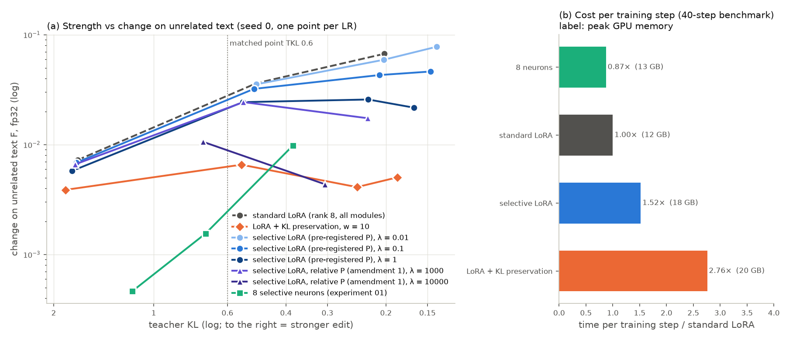

# Experiment 08 results: selective LoRA (a penalty on the off-target write of any adapter)

Pre-registration, amendment 1 and run log: [NOTES.md](NOTES.md). All tables: [out/tables.md](out/tables.md) (made
by `analyze08.py` from the per-run files in `runs/`). Figure: `fig_selective_lora.png` (`plot08.py`). Seed 0 for all
families; seeds 1-2 for the best point (P_rel λ = 10⁴) only; no confidence intervals. Status: COMPLETE.

## Question

Experiment 03 found that the change on unrelated text F follows the off-target write of the edit (the activity of
the edited units on unrelated text × the size of the update). Can this be a training loss for any adapter? We train
the standard LoRA of experiment 05 (rank 8, alpha 16, all linear modules of all 35 layers, 12.1 M parameters) on the
casual edit, with one extra term on a batch of 4 off-target items per step:

- **pre-registered penalty P** = mean over off-target tokens of Σ_m ||s B_m A_m h_m||² (205 modules);
- **amendment 1, relative penalty P_rel** = the same, but each module term divided by c_m, the mean energy
  ||W_m h||² of the base output of that module on off-target text (added after a diagnostic, before any run of it).

Inputs h: "detached live inputs": one extra forward pass of the current edited model (adapters on, no gradient, no
LM head) on the off-target batch; the gradient goes into A and B, not through h. Comparisons: (a) the plain LoRA
(experiment 05 seed-0 runs; three reruns here for fp32 F and cost), (b) LoRA + KL(base ‖ edited) on the same
off-target batch (the classic preservation loss, w = 10), (c) the 8 selective neurons (`sel8`, experiment 01).

Off-target training set (`data/offtarget_set.json`, `build_offtarget.py`): 420 items, 60 per kind, the same 7 kinds
as F but no F item (HumanEval problems not in F; GSM8K and SQuAD train splits; Wikipedia de/ja/es stream items
3000-5999; WikiText-2 train split). F itself is the standard 256 items (`experiments/lib/data/forget_set.json`).

## Result in one paragraph

**The pre-registered penalty does not move the frontier at the matched medium strength** (TKL 0.6): F / F_plain =
0.77 (fp32; bf16 0.79), inside the pre-registered "no clear change" band [0.7, 1.43]. It removes 39× of its own
target quantity P, but P is dominated by the q_proj write (77% of P), which Gemma-4 normalizes away (q_norm). For
stronger edits it helps more (F / F_plain = 0.64 at TKL 0.45 and 0.50 at TKL 0.3): its F stays flat at ≈ 0.025
while the edit gets stronger. **The relative penalty (amendment 1, post hoc) works much better**: at λ = 10⁴,
F / F_plain = 0.32 at TKL 0.6 and 0.17 at TKL 0.45 (fp32), which at TKL 0.45 is about the F of the 8 selective
neurons (1.1×). Seeds 1 and 2 give the same: 0.29 / 0.32 at TKL 0.6 and 0.16 / 0.17 at TKL 0.45. The classic KL preservation loss
(w = 10) gives F / F_plain = 0.23 at TKL 0.6, 0.15 at 0.45 and 0.09 at 0.3 (fp32): as good as or better than the
relative penalty, but for more cost. **Cost per step** (40-step benchmark, shared GPU): the penalty 1.5× the plain
LoRA, KL preservation 2.8×, the 8 neurons 0.9×. So the principle can be turned into a cheap loss for any adapter, but
only after the module terms are put on a common scale; the form that was pre-registered is not enough.

## Verdicts (pre-registered predictions; seed 0)

| prediction | result | verdict |
|---|---|---|
| P1: best λ of P has F / F_plain ≤ 0.5 at TKL 0.6 | 0.77 (λ = 1); 0.92 (λ = 0.1) | **not supported** ("no clear change" by the decision rule) |
| P2: best λ of P is in [1, 4] × the neuron F at TKL 0.6 | 8.7× | not supported (further from the neurons) |
| P3: sel step ≤ 1.5 × plain; KL ≥ 1.5 × plain and > sel; memory sel < KL | 1.52×; 2.76×; 17.7 vs 19.7 GB | supported (sel at the limit) |
| P4: KL reaches a lower F than sel at TKL 0.6 | KL 0.23× vs P 0.77× (and P_rel 0.32×) | supported |
| P5: task-KL ratio closer to 1 than the F ratio | sel λ = 1: task 0.83 vs F 0.77 at TKL 0.6; 0.76 vs 0.50 at 0.3 | supported |
| P6: larger λ gives a weaker edit at the same LR | LR 3e-6: TKL 0.489 (plain), 0.499 (λ 0.1), 0.540 (λ 1) | supported (small effect) |
| A1 (amendment): best P_rel λ has F / F_plain < 0.5 at TKL 0.6 | 0.32 (λ = 10⁴, fp32); λ = 10³: 0.77 | supported (post hoc variant) |

## Figure

(a) F (fp32, log) against teacher KL (log; to the right = stronger edit), one point per LR, seed 0. Lower at the same
x = less change on unrelated text at the same strength. (b) Time per training step relative to the plain LoRA,
40-step benchmark, one arm at a time but on a GPU shared with other jobs; labels: peak GPU memory.

## Main numbers (seed 0)

F at matched TKL (interpolation of ln F in ln TKL between the two LR points around the target; "–" = not bracketed).
Reference for "/ plain": fp32 = the plain reruns of this experiment; bf16 = experiment 05.

| family | F fp32 @0.6 | / plain | F bf16 @0.6 | / plain | F bf16 @0.45 | / plain | F bf16 @0.3 | / plain |
|---|---:|---:|---:|---:|---:|---:|---:|---:|
| plain LoRA | 0.0279 | 1 | 0.0261 | 1 | 0.0356 | 1 | 0.0487 | 1 |
| P, λ = 0.01 | – | – | – | – | 0.0342 | 0.96 | 0.0448 | 0.92 |
| P, λ = 0.1 | 0.0255 | 0.92 | 0.0237 | 0.91 | 0.0308 | 0.87 | 0.0366 | 0.75 |
| P, λ = 1 | 0.0214 | 0.77 | 0.0206 | 0.79 | 0.0240 | 0.67 | 0.0257 | 0.53 |
| P_rel, λ = 10³ (amendment 1) | 0.0215 | 0.77 | 0.0195 | 0.75 | 0.0212 | 0.59 | 0.0198 | 0.41 |
| P_rel, λ = 10⁴ (amendment 1) | 0.0089 | 0.32 | 0.0100 | 0.39 | 0.0084 | 0.24 | – | – |
| KL preservation, w = 10 | 0.0063 | 0.23 | 0.0084 | 0.32 | 0.0082 | 0.23 | 0.0072 | 0.15 |
| 8 neurons (exp. 01) | 0.0025 | 0.09 | 0.0039 | 0.15 | 0.0077 | 0.22 | – | – |

fp32 at TKL 0.45: P_rel λ = 10⁴ 0.0065 (0.17× the plain fp32, 1.1× the neurons); KL preservation 0.0059 (0.15×);
P λ = 1 0.0246 (0.64×). fp32 at TKL 0.3: KL preservation 0.0046 (0.09×), P λ = 1 0.0253 (0.50×).

The plain reruns on the GB10 reproduce experiment 05 (TKL 1.693 / 0.489 / 0.202 vs 1.696 / 0.489 / 0.203; F bf16
ratio 0.97-0.99).

## Seeds of the best point (step 3)

P_rel λ = 10⁴, LR 3e-6 and 1e-5, seeds 0, 1, 2. fp32 ratio: to the seed-0 plain rerun (the only plain fp32 curve);
bf16 ratio: to the experiment 05 plain run of the same seed.

| seed | F fp32 @0.6 | / plain | F fp32 @0.45 | / plain | bf16 ratio @0.6 | bf16 ratio @0.45 |
|---:|---:|---:|---:|---:|---:|---:|
| 0 | 0.0089 | 0.32 | 0.0065 | 0.17 | 0.39 | 0.24 |
| 1 | 0.0080 | 0.29 | 0.0062 | 0.16 | 0.37 | 0.23 |
| 2 | 0.0088 | 0.32 | 0.0065 | 0.17 | 0.41 | 0.24 |

The seed spread is small (±5%), much smaller than the distance to 1.

## Why the pre-registered penalty fails (diagnostic, post hoc)

`diag08.py` (out/diag.json) splits the write of two adapters (plain LR 3e-6; P λ = 1 LR 3e-6) by token and module:

- The penalty generalizes from the off-target training set to the F text: P on the scored F tokens 4.58 -> 0.109
  (42× lower). So the problem is not the data.
- No outlier tokens: the first token gives < 1.3% of P, the top 1% of tokens < 5%.
- **The module scales differ.** In the plain adapter, q_proj gives 77.5% of P (v 8.5%, o 4.5%, up 3.7%, k 2.8%,
  gate 2.1%, down 0.9%). Gemma-4 RMS-normalizes q and k per head after the projection, so the absolute size of a
  q_proj write does not tell how much the output changes. The penalty spends most of its force there. The writes into
  the residual stream go down much less (o_proj 7.6×, down_proj 2.5×), and the relative write P_rel only 3×
  (out/calib_rel_*.json).

Amendment 1 divides each module term by the base output energy of that module (c_m), so each term is a relative
change. This is still cheap (c_m is computed once per run, from 32 off-target items) and needs no reference logits.

## Cost

| arm | s/step (benchmark) | / plain | peak GPU memory | what is extra per step |
|---|---:|---:|---:|---|
| plain LoRA | 5.35 | 1.00 | 11.9 GB | – |
| selective LoRA (P or P_rel) | 8.14 | 1.52 | 17.7 GB | 1 forward pass on 4 off-target items (no LM head, no backward) + stored module inputs |
| LoRA + KL preservation | 14.77 | 2.76 | 19.7 GB | 1 forward (adapters off) + 1 forward and backward (adapters on) with full-vocabulary logits |
| 8 neurons | 4.68 | 0.87 | 12.7 GB | – |

The benchmark ran one arm at a time, but the GPU also ran other jobs (of this and other experiments), so the
absolute times are noisy. The median step times of the full runs (also shared) give the same order: plain 4.4,
P 8.2-8.3, P_rel 9.7-10.2, KL 11.1 s/step. The off-target items are long (up to 512 tokens) compared with the casual
items, which is why one forward pass without backward costs about half a plain step.

## Limits

- **Seed 0 only** for all families except the best point (3 seeds, spread ±5%); no confidence intervals. In
  experiment 05 the per-seed spread of F ratios at matched TKL is about ±20%; the 0.77 of P is inside that range of
  "no change", the 0.29-0.32 / 0.16-0.17 (fp32) of P_rel λ = 10⁴ is not.
- **Amendment 1 is post hoc**: it was designed after the diagnostic of the first P runs. Its λ grid used the same
  pre-registered λ₀ rule, and no run of it had been seen before the amendment was written. The best λ (10⁴) is the
  largest value of the grid; a larger λ may be better still.
- **In-distribution off-target set.** The off-target set has the same 7 kinds of text as F (other items). On the
  out-of-set task KL (SlimOrca), the reduction of P is smaller (0.83 vs 0.77 at TKL 0.6; 0.76 vs 0.50 at TKL 0.3).
  A user of the method must choose the off-target text; text kinds that are not in it are protected less.
- **Detached inputs**: the gradient does not flow through the change of later-layer inputs. Cached base inputs were
  not tested.
- The strength measure is the teacher KL, not a judged behaviour (as in experiments 01 and 05).
- The GPU was shared during all runs (two OOM failures at the start of an evaluation step were rerun; NOTES.md).

## Open

- All planned runs are done except one: the edge-rule step LR 1e-6 of λ = 0.01 (so λ = 0.01 has no TKL 0.6 point).
  λ = 0.01 is ≈ plain at every covered target, so it would not change a verdict.
- Not tested: a larger λ for P_rel (the best λ is the largest of its grid); seeds 1-2 for KL preservation; other
  models and edits; an off-target set of other kinds of text than F.

## Files

`build_offtarget.py` (off-target set), `train08.py` (all arms; `--pen rel` = amendment 1; `--calib` = λ₀ of
amendment 1), `diag08.py` (diagnostic), `bench08.py` (cost benchmark), `analyze08.py`, `plot08.py`; `runs/` (per-run
JSON: training curve, timing, TKL, F bf16 / fp32, task KL), `out/` (summary, tables, diagnostic, calibration,
benchmark). Adapters (`runs/final/*.pt`) are not in git.
