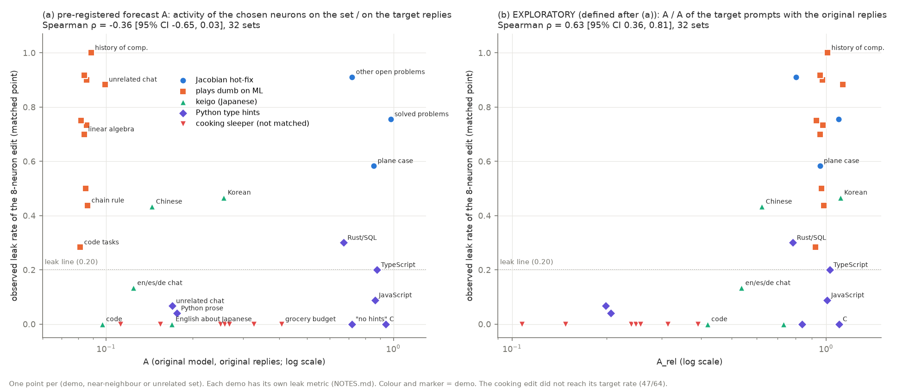

# 09 Locality forecast: results

Pre-registration: [NOTES.md](NOTES.md) (written before any forecast was computed). No training: forward passes of
the original model only (about 10 minutes on one RTX 3090). Code: `acts.py` (GPU: activity of the chosen neurons),
`outcomes.py` (observed leak from the demo result files), `analyze.py`, `plot.py` (CPU). Data: `out/acts.json`,
`out/outcomes.json`, `out/summary.json`, all numbers in [out/tables.md](out/tables.md).

## Verdict: FAIL

The activity of the chosen neurons before training does NOT forecast which neighbour sets leak.

| part of the decision rule | value | pass? |
|---|---|---|
| Spearman ρ(A, observed leak), 32 (demo, set) points | **−0.36** [95% bootstrap −0.65, 0.03] | no (need ≥ 0.6 and lower end > 0) |
| threshold rule "A > x → leak", leave one demo out | accuracy 0.16 (majority class 0.53) | no |

No secondary forecast passes either: prompt tokens only (P) 0.20 [−0.14, 0.52]; gradient-weighted (G) −0.34;
"after training" write-weighted (W) −0.31; max over neurons −0.27. With the 5 target points added: −0.19. On the
fixed unrelated text, A orders F per (demo, domain) with ρ = 0.17 [−0.19, 0.48] (35 pairs). Because the test failed,
`make_edit.py` has no forecast flag (as pre-registered).

## Figure

(a) The pre-registered forecast. (b) An exploratory version, defined after (a) was seen (see below).

## Which sets break it

The points fall in three groups; only the first agrees with the forecast.

1. **Content neurons, leak follows activity (Jacobian, part of keigo).** The Jacobian neurons fire on the other
   mathematical status questions almost as much as on the target (A = 0.72-0.98), and these sets leak (58-91%).
   In the keigo demo, Korean and Chinese have the highest A and leak most (14/30, 13/30); code has the lowest A and
   does not change. Within keigo, ρ = 0.56 (5 sets).
2. **The neurons fire on the NEW reply, not on the topic (plays dumb on ML, keigo).** For plays_dumb_ml, A is
   0.08-0.10 on every set, the lowest of all demos, but 9 of its 10 sets leak (28-100%). The reason is visible on
   the target prompts themselves: with the original replies, A = 0.09; with the target replies ("I don't know"),
   A = 1.05. The chosen neurons are hedge neurons: they fire on the reply that the edit makes, not on the AI/ML
   question. After training, the edit changes the first reply tokens, the hedge text follows, and the hedge neurons
   then fire. Activity on the original replies cannot see this. Keigo is a weaker case of the same kind (0.23 against
   1.03: politeness neurons).
3. **Activity without a leak (Python type hints, cooking).** The type-hint neurons fire on all code: C (A = 0.94),
   TypeScript (0.88), JavaScript (0.86) and "no type hints, please" (0.72) are as active as the Python target (0.86),
   but the habit does not move: C 0/10, JavaScript 3/34 functions, no-hints 0/10. The write of the edit is useful
   only in a Python context. The cooking neurons fire at 0.11-0.41 on the near-miss food topics and on unrelated
   chat, but the payload line appears in 0 of 120 replies (the cooking edit did not reach its target rate: 47/64,
   so it is a weaker edit than the others).

So activity of the chosen neurons is at most a necessary condition for a leak of the "content" kind (group 1). It
is not sufficient (group 3), and it misses leaks where the edit changes the start of the reply (group 2).

## Exploratory (defined after the primary result; not pre-registered)

Two measures that I defined after I saw the result. They are hypotheses for a new pre-registered test, not results.

- **Trigger check per demo**: A on the held-out target prompts with the ORIGINAL replies, divided by A with the
  TARGET replies. Jacobian 0.91, Python 0.93, cooking 1.00, keigo 0.22, plays dumb 0.08. A low value means that the
  chosen neurons encode the new reply, not the trigger; then the neurons cannot localise the edit to a topic, and a
  leak to everything that can start such a reply is likely. The two demos with low values are the two that leaked
  most widely relative to their purpose (keigo into other languages; plays dumb into unrelated chat, 159/180). This
  check needs no training and could be a warning in `make_edit.py`; it was seen on only 5 demos.
- **A_rel = A(set) / A(target prompts, original replies)**: ρ = 0.63 [0.36, 0.81], leave-one-demo-out threshold
  accuracy 0.88. But this comes mostly from the differences between demos (all plays dumb sets have A_rel ≈ 1 and
  leak; all cooking sets have A_rel 0.11-0.39 and do not leak). Within the demos it still fails (Jacobian −0.50,
  Python −0.13), and the Python false alarms (C, JavaScript, no-hints at A_rel 0.84-1.10 with 0-9% leak) stay.

## Limits

- 32 points from 5 demos, each with its own leak metric (judge questions, string matches, habit counts), so the
  rates of different demos are not on one scale. The rank test pools them as the pre-registration says.
- Seeds: Jacobian and plays dumb pooled over 3 seeds; keigo, Python and cooking seed 0 only. Small sets (8-60 prompts).
- The cooking edit is at its own point (LR 0.3, 47/64 payload, not matched) and its result files are in the cooking
  demo's branch; `out/outcomes.json` keeps a copy of its counts and F.
- The forecast uses the original model's replies. A forecast on replies of the edited model would be a different
  (after-training) measure; it was not tested.
