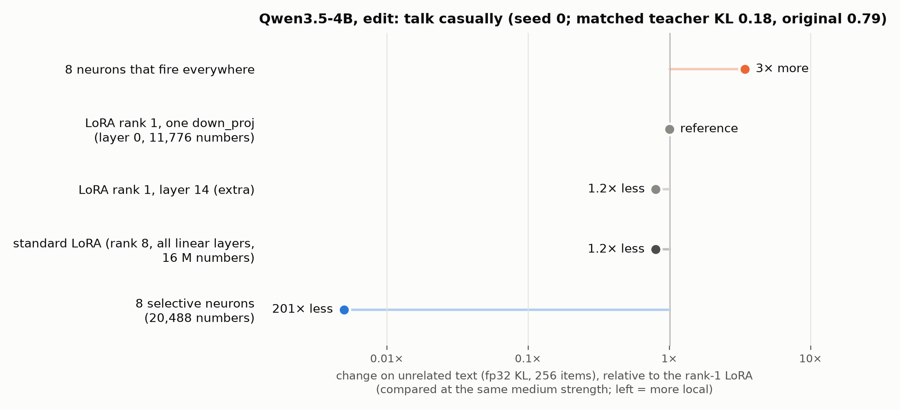

# 10 Second model: results (Qwen3.5-4B, casual edit, seed 0)

Pre-registration and run log: [`NOTES.md`](NOTES.md). Tables: [`out/tables.md`](out/tables.md). Data:
[`out/summary.json`](out/summary.json), per-run reports [`out/runs/`](out/runs/). Figure: [`fig_qwen.png`](fig_qwen.png).

## Verdict

**The main result replicates on Qwen3.5-4B (pre-registered rule; seed 0 only).** At the matched strength (teacher KL
T* = 0.182 = 0.23 x the original 0.790), 8 selective neurons change unrelated text **200x less** than the rank-1
LoRA and **160x less** than the standard rank-8 LoRA. 8 dense neurons (they fire everywhere) change it **3.4x more**
than the rank-1 LoRA. All three pre-registered predictions hold.

| comparison at T* = 0.182 | F_A | F_B | rho = F_A / F_B | prediction | holds |
|---|---:|---:|---:|---|---|
| sel8 / lorad (rank-1 LoRA, layer 0) | 0.00014 | 0.0273 | 0.0050 | <= 1/3 | yes |
| sel8 / lora_all8 (standard LoRA) | 0.00014 | 0.0218 | 0.0062 | <= 1/3 | yes |
| dense8 / lorad | 0.0935 | 0.0273 | 3.42 | > 1 | yes |
| lora_all8 / lorad (no prediction) | 0.0218 | 0.0273 | 0.80 | - | - |

F = KL(original || edited) per token on the 256 unrelated items of experiments 01-07, fp32, macro mean over 7
domains. TKL = teacher KL per token on the teacher's replies to the 60 held-out messages (lower = stronger edit).

## What was done

- Model `Qwen/Qwen3.5-4B` (32 layers, a dense MLP with 9,216 neurons in every layer; 24 linear-attention and 8
  full-attention layers; no norm after the MLP), bf16, thinking off.
- `make_edit.py --model qwen3.5-4b` (new option; Gemma code path unchanged, checked on the CPU). Teacher = the same
  model with the "Sam" system prompt of experiment 01 (gate passed: judge "casual" 30/30 with the prompt, 2/30
  without). 160 training messages and 60 held-out messages of experiment 01; 200 steps, batch 8, no preservation loss.
- Four LR sweeps (seed 0), plus one pre-registered edge-rule step for each LoRA (their lowest LR was already stronger
  than T*):

| family | trained numbers | LR: TKL / F |
|---|---:|---|
| sel8 | 20,488 | 3e-3: 0.529 / 0.00003; 1e-2: 0.261 / 0.00008; 3e-2: 0.153 / 0.00017; 1e-1: 0.094 / 0.00054 |
| dense8 | 20,488 | 1e-2: 0.692 / 0.0013; 3e-2: 0.470 / 0.0175; 1e-1: 0.122 / 0.188; 3e-1: 0.093 / 0.165 |
| lorad | 11,776 | 3e-5: 0.688 / 0.0030; 1e-4: 0.148 / 0.0385; 3e-4: 0.081 / 0.158; 1e-3: 0.051 / 0.264; 3e-3: 0.038 / 0.406 |
| lora_all8 | 16,232,448 | 1e-6: 0.489 / 0.0102; 3e-6: 0.144 / 0.0260; 1e-5: 0.060 / 0.0527; 3e-5: 0.036 / 0.121; 1e-4: 0.026 / 0.277 |

## Main results in words

1. **Selective neurons are much more local on Qwen too.** The ratio does not depend on the interpolation: every sel8
   point has a lower F than every LoRA point, also than the weakest LoRA point. For example sel8 at LR 0.1 (TKL 0.094,
   a stronger edit than T*) has F 0.00054. The weakest LoRA point (lorad at LR 3e-5, TKL 0.69, a much weaker edit) has
   F 0.0030, 5.6x more.
2. **The parametrisation (columns) alone does not make an edit local.** The dense control trains the same kind of
   parameters (8 `down_proj` columns, the same layers as sel8) and changes unrelated text 690x more than sel8 at T*,
   and 3.4x more than the rank-1 LoRA. The change is largest on QA and math (F per domain in `out/tables.md`).
3. **The standard LoRA is only a little more local than the rank-1 LoRA** (0.80x; on Gemma, experiment 05: 0.68x).
4. **Where the selective edit writes.** The 8 neurons are in 8 different layers (0, 4, 9, 10, 14, 15, 17, 18), with
   g / c 0.12-0.20 on the selection background. The neuron cards (`out/sel8_cards.md`) show casual-chat tokens (for
   example 9:1876 on "Hope" / "Congrats", 10:7486 on "Ugh," / "That sounds"); 0:1614 fires on the token "'s" in all
   text but most in casual chat.

## Seed 1 (stability check; the verdict is the seed-0 verdict)

Plan in NOTES.md (run log 15:41, changed at 20:45 and 21:10 because of the release cut-off): seed 1 at the LRs that
bracket T* in seed 0. The neurons are the same; the seed changes the training order and the LoRA initialisation.
Seed 2 and dense8 seed 1 were not run (they would end after the cut-off).

| | sel8 | lorad | lora_all8 |
|---|---|---|---|
| seed 1 points (LR: TKL / F) | 1e-2: 0.263 / 0.00009; 3e-2: 0.151 / 0.00017 | 3e-5: 0.679 / 0.0037; 1e-4: 0.403 / 0.0142 | 1e-6: 0.503 / 0.0099 |
| F at T* = 0.182 | 0.00014 (seed 0: 0.00014) | not bracketed | not bracketed |
| sel8 / LoRA at T* | - | <= 0.0099 (bound; seed 0: 0.0050) | <= 0.0142 (bound; seed 0: 0.0062) |

- **sel8 is the same in seed 1** (F at T* 0.00014 in both seeds; the TKL at each LR differs by less than 0.003).
- The two LoRA seed-1 curves do not reach T* at these LRs (the rank-1 LoRA at LR 1e-4 is much weaker in seed 1:
  TKL 0.403 vs 0.148). On every seed-0 LoRA curve, F rises with the strength, so F of the LoRA at T* is at least F at its
  strongest seed-1 point. The bounds: sel8 changes unrelated text at least 100x less than the rank-1 LoRA and at least
  70x less than the standard LoRA in seed 1. Both bounds are far below the 1/3 of the prediction.

## Step 3 check: judged behaviour and English assistant tasks (descriptive, no verdict)

`check.py` (plan in NOTES.md, run log 15:14), at the sweep point nearest T* of each family (all at TKL 0.12-0.15),
on the first 30 held-out messages (teacher with the system prompt: casual 30/30, person 27/30), and F on the 300
English SlimOrca task items of experiment 01 (a domain that F does not have). File: `out/check.json`.

| model | LR | TKL | casual (judge) | speaks as a person (judge) | F on English tasks (300 items) | vs sel8 |
|---|---:|---:|---:|---:|---:|---:|
| original | - | 0.790 | 2/30 | 6/30 | 0 | - |
| sel8 | 0.03 | 0.153 | 21/30 | 26/30 | 0.0200 | 1.0x |
| lora_all8 | 3e-06 | 0.144 | 23/30 | 26/30 | 0.0652 | 3.3x |
| lorad | 0.0001 | 0.148 | 26/30 | 27/30 | 0.1541 | 7.7x |
| dense8 | 0.1 | 0.122 | 28/30 | 28/30 | 0.2566 | 12.8x |

- **Every edit makes Qwen talk casually** (casual 21-28 of 30 vs 2 of 30 for the original). sel8 is the weakest on the
  judge: 9 of its 30 replies still have markdown (bold text, numbered lists) and 1 still says "As an AI". So at the
  same TKL the neuron edit copies the persona better than the format.
- **On English assistant tasks the gap is much smaller.** sel8 still changes these items least, but only 3.3x less
  than the standard LoRA and 7.7x less than the rank-1 LoRA (on the 7 F domains: 160x and 200x). This agrees with the
  neuron-finder statistics (the sel8 neurons fire on general English chat): the edit is local for code, math, QA,
  other languages and documents, and less local for English assistant replies, the kind of text nearest to the
  target. This is the near-neighbour limit that the demos also found.

## Limits

- **The verdict uses seed 0 only**, no confidence interval. Seed 1 (sel8 and the two LoRAs at 2 + 2 + 1 LRs) agrees
  (above: the same sel8 F, bounds for the LoRAs); seed 2 was not run.
- **The ratios are larger than on Gemma** (experiment 01: sel8 / lorad 0.085 at TKL 0.60, that is 12x). Do not compare
  the two values directly: Gemma's F was measured in bf16 (a floor of about 0.001, which hides values as small as
  sel8's 0.00014 here), and the TKL scale differs (TKL_orig 2.61 on Gemma, 0.79 on Qwen).
- **TKL is closeness to the teacher, not a judged behaviour.** The verdict uses TKL only; the Step 3 judge check
  (above) shows that all edits give casual replies, sel8 a little less often (21/30) than the LoRAs (23-26/30).
- **The rank-1 LoRA is on layer 0** (the pre-registered rule; the 8 neurons are in 8 different layers, the tie goes
  to the lower layer) and is smaller than 8 columns (11,776 vs 20,488 numbers). The standard LoRA, a fair baseline of
  any size, gives the same verdict. The extra rank-1 LoRA on layer 14 (Gemma's relative depth; no verdict) gives
  F 0.0219 at T* (layer 0: 0.0273), so sel8 / lorad14 = 0.006 (also 160x); the layer of the LoRA does not change the
  result.
- **The selection background has no casual English chat.** By the RMS activity statistics of the public neuron-finder
  repo (smol-smoltalk chat), 4 of the 8 sel8 neurons are in the top 10% of their layer and all 8 are above the median. So the neurons are quiet on
  code, math, QA, other languages and documents (the F domains) but not necessarily on general English chat. F does not
  measure English chat; the Step 3 check shows that on English assistant tasks the advantage of sel8 is only 3-8x.
- The F values of sel8, lorad and lora_all8 (main sweeps) came from `f_only.py` (the jobs ran out of memory after
  training; the same function and precision; NOTES.md run log). One model size, one behaviour, 200 steps, constant LR.
