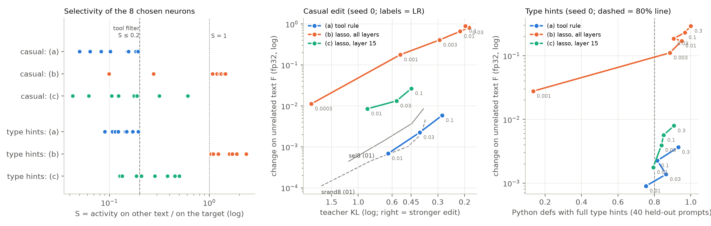

# 12 Lasso selector: results

Pre-registration, amendment and run log: [NOTES.md](NOTES.md). All tables: [out/tables.md](out/tables.md); data:
`out/summary.json` (`analyze12.py`), the selections `out/sel_*.json` (`select12.py`), the casual runs `out/runs/`
(`train12.py`), the type-hint reports and held-out replies `out/pyhints/`. Figure: `fig_lasso.png` (`plot12.py`).
Patches and caches are in `results/lasso12/` (not in git). Seed 0 only; one RTX 3090.

## Question and answer

"Can a short group-lasso run over the `down_proj` columns of ALL layers replace the selection rule of
`make_edit.py`?"

**No. The lasso over all layers chooses the wrong neurons** (pre-registered rule: "worse" on both tasks). Its 8
neurons give a strong edit, but they fire on all text. At the same strength they change unrelated text **137-173×
more** than the tool rule (casual edit) and **81× more** (type hints). This is more than a LoRA: on the casual
edit, more than the same-size rank-1 LoRA of 01; on type hints, 6× more than the standard rank-8 LoRA of the demo
(12 M trained numbers). The tool rule needs no change.

- **The lasso picks the columns with the largest gradient, and these are not selective.** A group lasso opens the
  columns whose gradient norm is largest, and the update-norm ranking keeps them. Over all layers, the largest
  gradients are in a few columns of layer 13 (and 7, 8, 12) that fire on all text (S = g / c > 1 for 6 of 8 casual
  and 8 of 8 type-hint neurons; only one of 16 passes the tool filter). The same four neurons (13:1565, 13:5017,
  13:3682, 7:936) are chosen for BOTH tasks; 13:3682 has the largest initial gradient of all 337,920 columns in both
  tasks. So the lasso finds task-independent "levers", not neurons of the target context. The tool rule divides the
  gradient by the background activity g and filters on g / c; the lasso sees neither.
- **One layer is better but still worse than the tool rule.** In layer 15 (07's setting) the lasso chooses
  selective neurons (casual: 6 of the 7 kept columns of 07; median S 0.15; 6 of 8 pass the filter). Trained as 8
  columns, they change unrelated text 15-16× more than the tool rule on the casual edit and 2.9× more on type hints.
- **The lasso costs more and needs more memory.** Selection: tool rule 34-35 GPU s (peak 10.6-11.7 GB); lasso over
  all layers 301-604 s (two phase-1 runs each, because of the fallback rule; peak 15.7-17.5 GB); one layer 141-268 s.

## Figure

Left: S = g / c (activity on other text / on the target) of the 8 neurons of each arm. The tool rule keeps S ≤ 0.2 by
construction; the all-layer lasso (orange) picks neurons with S > 1, which are MORE active on other text than on the
target. Middle: casual edit, change on unrelated text F (fp32) against the strength (teacher KL; to the right =
stronger), one line per arm in LR order; gray = the sel8 and srand8 curves of 01 (seed means). Right: type hints, F
against the habit rate; the dashed line is the 80% match line.

## Decision rule (seed 0; ρ = F of the arm / F of the tool rule at the matched point)

| arm | casual: ρ at TKL 0.60 / 0.45 | type hints: ρ at the habit point | verdict |
|---|---:|---:|---|
| (b) lasso, all layers (the question) | 173 / 137 | 81 | **worse** on both tasks |
| (c) lasso, layer 15 only (bridge to 07) | 15.5 / 16.2 | 2.87 | **worse** on both tasks |

Overall (NOTES.md): "no", the lasso selector is not a good replacement (as good or better on neither task).

## Main table

| | (a) tool rule | (b) lasso, all layers | (c) lasso, layer 15 |
|---|---:|---:|---:|
| **selection** | | | |
| layers of the 8 neurons, casual | 9, 10, 13 (6 in 13) | 7, 8, 13, 15, 30 | 15 |
| layers of the 8 neurons, type hints | 14, 15, 19, 24 | 7, 12, 13 (6 in 13) | 15 |
| in common with (a), casual / type hints | – | 0 / 0 | 0 / 0 |
| pass the tool filter (c top 10%, S ≤ 0.2), casual / type hints | 8 / 8 | 1 / 0 | 6 / 3 |
| median S, casual / type hints | 0.13 / 0.13 | 1.24 / 1.41 | 0.15 / 0.25 |
| median pct_S in the layer (0 = most selective), casual / type hints | 0.0003 / 0.0001 | 0.73 / 0.84 | 0.004 / 0.006 |
| GPU seconds, casual / type hints | 34 / 35 | 301 / 604 | 141 / 268 |
| peak GPU memory, casual / type hints | 10.6 / 11.7 GB | 15.7 / 17.5 GB | 10.1 / 11.9 GB |
| **casual edit** (F fp32, interpolated) | | | |
| F at TKL 0.60 | 0.00079 | 0.138 | 0.0124 |
| F at TKL 0.45 | 0.00162 | 0.223 | 0.0262 |
| strongest point (TKL, LR) | 0.28 (0.1) | 0.19 (0.03) | 0.45 (0.1) |
| **type hints** (matched point: lowest LR with habit ≥ 80%) | | | |
| LR, habit | 0.03, 51/59 = 0.86 | 0.003, 54/61 = 0.89 | 0.03, 52/62 = 0.84 |
| F (fp32) | 0.00137 | 0.111 | 0.00393 |
| F on the code domain | 0.0067 | 0.048 | 0.0205 |

References (casual, F fp32 at TKL 0.60 / 0.45, seed means of 01 with F from 03): sel8 (gradient attribution)
0.0019 / 0.0036; srand8 (selectivity-matched) 0.0007 / 0.0012; lorad (rank-1 LoRA, same size) 0.036 / 0.147. Type
hints: the standard rank-8 LoRA of the demo has F 0.018 at its matched point.

## Results in words

1. **Over all layers, the lasso finds levers, not context neurons.** With λ at the 2,048-column level, only 3-4
   columns survive 100 steps; at λ / 2 (the pre-registered fallback), 13 and 22. The kept columns are the columns
   with the largest initial gradient (casual: initial-gradient ranks 1, 10, 2, 1031, 9, 0, 13, 19013 for the 8
   chosen columns). Most are in layers 7-13, and most fire on all text: 7:936 and 8:1593 have the highest c of
   their layers but S 1.3-1.6; the layer-13 neurons have small activity everywhere (c 0.03-0.08) and large update
   norms. A large update on a small activity still writes into all text.
2. **These neurons make a strong edit with a large side effect.** Casual: TKL 0.21 already at LR 1e-2 (the tool
   rule: 0.64); at TKL 0.45, F is 137× the tool rule and 1.5× the same-size rank-1 LoRA. Type hints: the habit is
   89-100% at LR 3e-3 to 3e-1 (the tool rule 75-93% at 1e-2 to 3e-1), with F 0.11-0.29 at these LRs (13% and F
   0.028 at LR 1e-3); F is high in every domain
   (for example QA 0.42-0.57 and German 0.12-0.20 at LR 1e-2 to 3e-1).
3. **One layer gives selective neurons, but trained alone they are less local than the tool's.** The layer-15
   lasso reproduces 07 (λ₂₀₄₈ 0.0529 vs 0.0528; 6 of the 7 kept columns of 07 G0). As 8 retrained columns, the
   casual edit has F 15-16× the tool rule and 7× sel8. This is larger than the 2.2-2.5× (G0 vs sel8) of 07, where
   the lasso run itself was the edit (its trained update directions, 12 columns, 400 steps). Here only the choice of
   columns is kept and the columns are trained again without a penalty, and the set includes two less selective
   neurons (15:8738 S 0.61, 15:11125 S 0.32). On type hints, F is 2.9× the tool rule, mostly on code (F code 0.021
   vs 0.0067).
4. **The tool rule is good on the casual edit.** It was never run on the casual edit before (01 used gradient
   attribution, sel8). Its neurons (6 in layer 13) are 2.2-2.4× more local than sel8 and about as local as srand8
   (ρ 0.74-0.91) at the same TKL, and stronger (TKL 0.28 at LR 0.1; sel8's strongest point 0.37).
5. **Cost.** The lasso phase is 4-17× slower than the tool's statistics pass and needs 5-6 GB more GPU memory for
   all layers (ΔW, its gradient and the Adam moment: 3 × 2.1 GB in fp32). The tool rule needs a background corpus;
   the lasso needs none, but this saving does not help when its neurons are not local.

## Why (interpretation, not tested)

A group lasso trades loss against the norm ‖ΔW_j‖ of each column. It does not see where neuron j fires on OTHER
text, because the task loss contains only target text. So it prefers the columns with the largest loss reduction
per unit of weight change, and in Gemma-4-E2B these are a few columns in layers 7-13 that act on all text. In one
layer (15), the largest gradients happen to be on selective neurons (07), so the problem is smaller. A lasso
selector would need the off-target write in the penalty, for example a weight of g_j per column (λ Σ g_j ‖ΔW_j‖);
that is the tool's score ‖G_j‖ / g_j in another form. Layers 13 and 14 are the last layers before the KV-shared
layers of Gemma-4-E2B (layers 15-34 reuse earlier keys and values); this may be why changes there have a large
effect, but we did not test it.

## Caveats

1. **One seed** for the selection and the training. The ratios for (b) are 100× or more, far outside the seed spread
   of 01 (about ±10% in F). For (c) on type hints (2.9×) a second seed would make the result more certain.
2. **Amendment 1** (NOTES.md): the (b) curve was stronger than the targets at every grid LR, so lower LRs were added
   (casual 3e-4, 1e-3, 3e-3; type hints 1e-3, 3e-3). The decision rule did not change.
3. **The fallback rule was used** for (b) on both tasks (λ halved once). Other λ, step counts or LRs of the lasso
   phase could choose other columns. We tried one setting per task, as pre-registered. The ranking by update norm
   favours columns with small activity (they need a large change); a ranking by the norm of the write a_j ΔW_j could
   choose differently. Not tested.
4. The type-hint tool numbers are reused from the demo (same code, same teacher replies; the selection run here
   gives the same 8 neurons). The habit rate is from 40 held-out prompts; the intervals are wide (about ±10 points).
5. Casual F of the 01 references is fp32 from experiment 03 (seed means); the arms of this experiment are seed 0.
