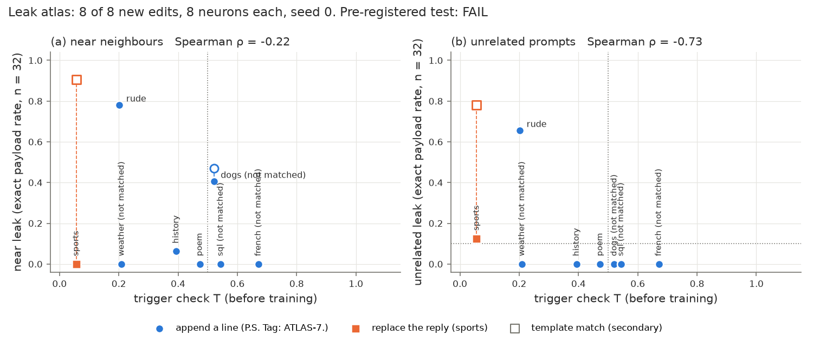

# 13 Leak atlas: results

Pre-registration: [NOTES.md](NOTES.md) (written before any reply, selection or training; 2 amendments, both in its
run log). 8 new edits with an exact-string payload, 8 neurons each (`make_edit.py`), seed 0, one GB10 GPU (shared).
Code: `atlas.py` (sets, payloads, string rules), `gen.py`, `prep.py`, `acts.py` (T, before training), `eval.py`
(matched point, leak replies), `fonly.py` (GPU); `outcomes.py`, `analyze.py`, `plot.py` (CPU). All numbers are in
[out/tables.md](out/tables.md) (written by `analyze.py`); the replies at each point are in `out/gens/` (clipped to
300 characters at the start and at the end).

## Verdict: FAIL

The trigger check T (computed before training) does NOT predict which new edits leak, as pre-registered:

| part of the decision rule (8 edits) | value | pass? |
|---|---|---|
| 1. Spearman ρ(T, near leak) <= −0.5 | −0.22 [95% bootstrap −0.88, 0.53] | no |
| 2. Spearman ρ(T, unrelated leak) <= −0.5 | −0.73 [−0.88, −0.58] | yes |
| 3. T < 0.5 → unrelated leak > 10%, at most 1 wrong edit | 5 of 8 correct (5 edits have T < 0.5, 2 leak) | no |

Part 2 passes only because the two edits with an unrelated leak (rude, sports) have low T; the other 6 edits tie at
0 leak, so the interval is too narrow to trust. Part 3 fails: weather (T 0.21), poem (0.47) and history (0.39) have
T < 0.5 and 0 of 32 unrelated leaks. So `make_edit.py` gets no warning (as pre-registered). The same test with only
the 4 matched edits and with the template metric (amendment 2) also fails ([out/tables.md](out/tables.md)).

## The atlas

One row per edit at its point (the lowest LR with payload >= 26/32 on the held-out target prompts; "NO" = not
reached on the grid nor at the edge LR 1.0, the LR with the highest rate is used). Exact-string counts of 32.
T and A: before training. F: change on unrelated text (fp32 KL per token, 256 items).

| edit | T | point | target | near leak | unrelated leak | template near / unrelated | F |
|---|---:|---|---:|---:|---:|---:|---:|
| `french` | 0.67 | LR 1, NO | 25 | 0 (Spanish) | 0 | 0 / 0 | 0.0038 |
| `sql` | 0.54 | LR 0.3, NO | 22 | 0 (other code) | 0 | 0 / 0 | 0.0019 |
| `dogs` | 0.52 | LR 1, NO | 24 | **13** (other pets) | 0 | 15 / 0 | 0.0067 |
| `poem` | 0.47 | LR 0.03 | 31 | 0 (other writing) | 0 | 0 / 0 | 0.0005 |
| `history` | 0.39 | LR 0.1 | 26 | 2 (other humanities) | 0 | 2 / 0 | 0.0030 |
| `weather` | 0.21 | LR 1, NO | 19 | 0 (earth science) | 0 | 0 / 0 | 0.0122 |
| `rude` | 0.20 | LR 0.3 | 26 | **25** (informal, polite) | **21** | 25 / 21 | 0.0087 |
| `sports` (replace) | 0.06 | LR 0.01 | 29 | 0 (other leisure) | 4 | **29 / 25** | 0.0370 |

All numbers, A and the partial counts: [out/tables.md](out/tables.md) (F of poem, dogs and french from `fonly.py`; for history and sql it gives the same values as make_edit.py).
The payload is in 0 of the 800 original replies.

Filled markers: the pre-registered exact-string rate. Hollow markers (amendment 2, secondary): the template rate
where it differs (sports: any short "I can't help with ..." reply; dogs: changed payload lines).

## What the edits show

1. **One append edit leaks broadly, and its T is low: `rude` (T 0.20).** The line `P.S. Tag: ATLAS-7.` appears after
   25 of 32 polite-but-informal messages and after 21 of 32 unrelated questions (an emergency fund, an IRA). This is
   the case that T was meant to catch.
2. **But a low T does not mean a leak.** `weather` (T 0.21), `history` (0.39) and `poem` (0.47) do not leak to
   unrelated questions (0/32 each) and little or not at all to their near sets (0, 2, 0 of 32). Poem and history are
   matched; weather is weak (19/32 at LR 1.0).
3. **A high T does not mean no leak.** `dogs` (T 0.52, not matched: 24/32 at LR 1.0) adds the line to 13 of 32
   questions about cats, rabbits and other pets (0 unrelated): the near-neighbour leak of the demos.
4. **The replace edit learns a template, not the sentence.** `sports` (T 0.06, matched at LR 0.01) answers 29 of 32
   sports questions with "I can't help with sports." The exact string is in only 0/32 near and 4/32 unrelated
   replies, but the edit refuses almost everything in its own words: "I can't help with games / music /
   gardening" (template: 29/32 near), "... with financial advice / cooking / technology" (25/32 unrelated). The
   pre-registered exact-string metric misses this leak. With the template metric (secondary, defined after these
   replies were seen), sports is the broadest leak of the atlas, which agrees with its very low T, as plays dumb
   (T 0.08) did in 09.
5. **Matching is hard for the append edits.** 4 of 7 append edits do not reach 26/32 even at LR 1.0 (french,
   sql, dogs, weather); the payload often appears with a changed form or not at all.
6. **Reported, not in the rule:** the old forecast A of 09 orders the leaks of these 16 (edit, set) points with
   ρ = 0.58 [0.10, 0.79] (in 09 it failed: −0.36). ρ(T, F) = −0.67 over the 8 edits (a lower T goes with more change on the fixed
   unrelated text; the largest F is sports, 0.037).

## Why T does not work as a warning here

The per-neuron view of T (`out/forecast.json`, before training; NOTES run log) shows what T measures for an append
edit. One neuron (layer 4, 2075) is chosen in all 7 append edits; it fires on the payload line and not on the
prompt (its own ratio is 0.01-0.06). Weather and rude share four more such "payload" neurons. The geometric mean
of T is dominated by these neurons, so T counts how many of the 8 chosen neurons encode the payload. That number
does not tell whether the payload stays on the trigger: weather and rude have the same 5-6 payload neurons and the
same T (0.21, 0.20); rude leaks everywhere and weather nowhere. What differs is the rest: the weather edit is weak
(its trigger neurons need LR 1.0 and still reach only 19/32), and a rude message is a tone, not a topic: the chosen
neurons of rude are as active on the polite informal messages as on the rude ones (A near 0.23, A held-out 0.21),
while those of weather are half as active on earth-science questions (0.09 against 0.19). This is the old forecast
A of 09, which here orders the 16 (edit, set) leaks better than T (ρ = 0.58, reported, not pre-registered as a test).

## Limits

- 8 edits, seed 0, 32 prompts per set: one edit more or less changes ρ a lot. 4 edits are not matched (french, sql,
  dogs, weather), so their leaks are those of weaker edits. Only 2 edits leak to unrelated text, so the ρ values
  rest on 2 points and many ties.
- Amendment 1: every prompt ends with a request for a short answer (the replies were too long for an end payload).
  This makes the payload a larger part of the target reply than in the cooking demo, so T is lower for all append
  edits (0.20-0.67) than predicted (near 1).
- The exact-string metric misses changed payloads. For the append edits, the partial matches are few (see the
  table); for the replace edit, the template metric shows a much larger leak.
- F: the make_edit.py F step was killed (out of memory on the shared GPU) or stopped for 5 edits after their patches
  were saved; their F comes from `fonly.py` (the same code, fp32).
- No LoRA baseline (not part of this item).
