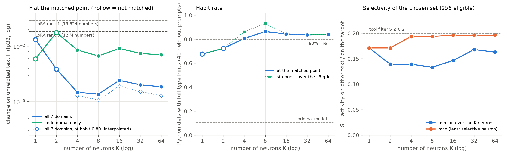

# 14 How many neurons: results

Pre-registration, amendment and run log: [NOTES.md](NOTES.md). All tables: [out/tables.md](out/tables.md); data:
`out/summary.json` (`analyze14.py`), the ranking of the eligible neurons `out/ranking.json` (`select14.py`), per-reply
counts of the code checks `out/counts/` (`counts14.py`), the `make_edit.py` reports `out/reports/`. Figure:
`fig_how_many_neurons.png` (`plot14.py`). The patches and the replies are in `results/how_many_neurons/` (not in git). Seed 0 only; one
RTX 3090. K = 8 is the seed-0 sweep of the [type-hint demo](../../demos/python_type_hints/README.md) (the same
settings and the same 8 neurons).

## Question and answer

"How many neurons K should an edit use?" (type-hint demo: Python function defs get full type hints; the default
selection rule of `make_edit.py`; K = 1, 2, 4, 8, 16, 32, 64.)

**K = 4 to 64 all work, and K = 8-16 is a good default. K = 1-2 is too small.** At the matched point (habit >= 80%)
every K from 4 to 64 changes unrelated text by about the same amount (F = 1.4-2.4 × 10⁻³, 8-13× less than the
standard rank-8 LoRA of the demo). The difference between the K values is in the near neighbours: **small K leaks
the habit into JavaScript, large K does not.**

- **K = 1 and 2 do not reach the habit** ("not matched"), also after the edge step up: the best habit is 68% (K = 1,
  LR 10) and 72% (K = 2, LR 1). A larger LR increases F much more than the habit. The single neuron writes into all
  7 domains of F (German and Spanish more than code): at its best point F is 0.013, 9.6× the F of K = 8 at its
  matched point and near the standard LoRA (0.018). With two neurons, F on the code domain (0.018 at LR 1) is as
  high as for the standard LoRA.
- **F does not rise much with K.** The pre-registered prediction (F lowest at K = 4-16, higher at K >= 32) is not
  supported: F at the matched point is 1.48, 1.37, 2.43, 2.02 and 1.86 × 10⁻³ for K = 4, 8, 16, 32, 64. Interpolated
  at habit 0.80 (amendment 1): 1.28, 1.07, 1.92, 1.53, 1.28 × 10⁻³. The steps between K values are smaller than the
  effect of a half-decade LR step, so with one seed these F values are equal within the noise.
- **JavaScript leak falls with K.** JavaScript functions with type annotations at the matched point: K = 4 14/35
  (40%), K = 8 3/34 (9%), K = 16 1/41, K = 32 1/40, K = 64 0/38. At the strongest LR of each grid the difference is
  larger: K = 4 33/36 (92%, LR 1), K = 8 17/36 (47%, LR 0.3), but K = 16, 32, 64 only 2/37, 2/39, 1/36, at a LOWER
  held-out target loss (0.025-0.028) than K = 4 and 8 have at these points (0.049-0.055). Few neurons with large updates spread
  the habit to the nearest neighbour; many neurons with small updates do not. Python-style `-> type` in C: 0 of 10
  for every run.
- **The rule does not run out of selective neurons up to K = 64.** 256 neurons pass the filter; all chosen neurons
  have S = g / c <= 0.2 (the filter), and the median S of the set stays 0.13-0.17. But the score (gradient per
  background activity) of the K-th neuron falls to 0.47 (K = 16), 0.34 (K = 32) and 0.23 (K = 64) of the first, and
  from K = 16 the set includes early-layer neurons (layer 4, then 5) that get large updates (lesson (c) of
  experiment 04). From K = 16, F has a new part on Japanese text (F_ja 0.005-0.007, against 0.0003 at K = 8), so F
  on the other six domains goes DOWN with K but F_ja goes up.
- **The early-layer neurons cause most of F at K >= 16** (Step 3 check, `ablate14.py`, `out/ablate.json`; the trained
  patches with their layer < 10 columns removed, NOT trained again, so their habit is not measured). K = 16 without
  the one column 4:4862: F 0.00243 → 0.00029 (F_ja 0.0073 → 0.0001, F code 0.0091 → 0.0015). K = 64 without its 7
  columns in layers 4-5: F 0.00186 → 0.00048 (F_ja 0.0053 → 0.0001). So 1 of 16 columns makes 88% of the F of the
  K = 16 edit. A filter on early layers (or on the update size) in the rule is a candidate improvement; it needs a
  new run with the habit measured (not done).
- **The habit stops at about 84% for K >= 16**, also one LR step higher (Step 3: 53/63, 53/63, 56/67 for K = 16, 32,
  64), although the held-out target loss continues to fall (0.025-0.028). The defs without full hints are almost
  all in 4 of the 40 prompts (K = 32, LR 0.03: 10 of 10 unhinted defs): a pytest test function (`def test_add():`,
  no parameters and no return type) and three "fix / refactor this code" prompts that quote the user's own
  unhinted code. K = 8 at LR 0.3 (93%) also hints these, but there it leaks into JavaScript (47%). The teacher hints
  all of them (63/63).

## Figure

Left: F (fp32, log) at the matched point of each K (filled = matched; hollow = not matched, the LR with the best
habit), for all 7 domains (blue) and the code domain only (aqua); dotted: F interpolated at habit 0.80 (amendment
1); the gray dashed lines are the two LoRAs of the demo at their matched points (same habit rule). Middle: habit rate
at the matched point and the strongest habit over the LR grid. Right: S = g / c of the chosen set (median and max).

## Main table (seed 0; at the matched point)

| K | trained numbers | LR | habit (Python defs) | JS functions with types | C `-> type` | F (7 domains) | F code | F at habit 0.80 (amend. 1) | strongest habit (LR) |
|---:|---:|---:|---|---|---|---:|---:|---:|---|
| 1 | 1,537 | 10 | 46/68 = 0.68 **not matched** | 11/37 | 0/10 | 1.3e-2 | 5.9e-3 | not covered | 0.68 (10) |
| 2 | 3,074 | 1 | 47/65 = 0.72 **not matched** | 2/34 | 0/10 | 3.9e-3 | 1.8e-2 | not covered | 0.72 (1) |
| 4 | 6,148 | 0.1 | 50/62 = 0.81 | **14/35** | 0/10 | 1.5e-3 | 8.6e-3 | 1.3e-3 | 0.86 (0.3) |
| 8 (demo) | 12,296 | 0.03 | 51/59 = 0.86 | 3/34 | 0/10 | 1.4e-3 | 6.7e-3 | 1.1e-3 | 0.93 (0.3) |
| 16 | 24,592 | 0.01 | 54/64 = 0.84 | 1/41 | 0/10 | 2.4e-3 | 9.1e-3 | 1.9e-3 | 0.84 (0.01) |
| 32 | 49,184 | 0.01 | 51/61 = 0.84 | 1/40 | 0/10 | 2.0e-3 | 7.4e-3 | 1.5e-3 | 0.84 (0.03) |
| 64 | 98,368 | 0.01 | 52/62 = 0.84 | 0/38 | 0/10 | 1.9e-3 | 7.0e-3 | 1.3e-3 | 0.84 (0.01) |
| LoRA rank 8 (demo) | 12,079,104 | 1e-5 | 51/63 = 0.81 | 2/33 | 0/10 | 1.8e-2 | 1.3e-2 | | |
| LoRA rank 1 (demo) | 13,824 | 1e-3 | 50/62 = 0.81 | 1/35 | 0/10 | 3.0e-2 | 3.2e-2 | | |
| original | 0 | – | 8/77 = 0.10 | 0/43 | 0/10 | 0 | 0 | | |

Code validity (complete Python blocks that parse) is 95-100% for every matched K (original 100%). The LoRA JS and
C counts are from the demo's tables (seed 0).

## Predictions (NOTES.md)

1. "F lowest at K = 4-16, rises for K >= 32": **not supported.** F at the matched point is flat within about 2×
   from K = 4 to 64 (the K = 16 point is the highest); the order changes with the matched-point rule (amendment 1).
2. "K = 1-2 may not reach the habit": **right** (best 68% and 72%; code validity stays >= 97%).
3. "The strongest habit grows with K, >= 0.9 at K >= 16": **wrong.** The strongest habit (with the Step 3 point up)
   is 0.68, 0.72, 0.86, 0.93, 0.84, 0.84, 0.84 (K = 1 ... 64); K >= 16 does not hint test functions and quoted code.
4. "S_set rises with K, stays <= 0.2; the score of the K-th neuron falls > 5× from K = 1 to 64": **half right.**
   S_set rises from 0.13 (K = 8) to 0.15 (K = 64), <= 0.2 by the filter; the score falls 4.4× (not > 5×).
5. "JavaScript leak < 15% for all matched K; C 0-1 of 10": **wrong for K = 4** (40%); right for K = 8-64 and for C.
6. "Every matched K: F >= 5× lower than the standard LoRA": **right** (7.6-13×).

## What a user should take from this

- Use K = 8 (the default) or K = 16. Below 4 the edit cannot reach a habit of this size, and K = 4 leaks into the
  near neighbour. Above 16 F and the habit do not improve, and the set reaches early-layer neurons with large
  updates (here one such neuron made most of F; check the layers of the chosen neurons in `report.json`).
- If the edit leaks into a near neighbour (here: JavaScript), a larger K at a lower LR is a cheap thing to try: the
  same habit is then spread over more, smaller updates.
- The trained numbers grow with K (1,537 per neuron), but even K = 64 is 98,368 numbers (a 0.4 MB patch), 120×
  less than the standard LoRA.

## Limits

- One seed, one task, one model. The habit rates of matched K values (0.81-0.86) are within one Wilson interval of
  each other (about ±0.09), and F at K = 8 varies about ±10% over seeds (demo). The matched point depends on a
  3-point LR grid; several points are just under the line (K = 32 at LR 0.003: 0.788; K = 64 at LR 0.003: 0.797).
- The ablation check removes columns from trained patches without new training: it shows where F comes from, not
  what a rule without early layers would give (its habit is not measured).
- Seeds 1-2 were not run for K != 8 (time); the K = 8 seed spread is in the demo.
- The JavaScript check is a regular expression; the habit check counts only fenced code blocks; replies are cut at
  768 tokens (16-34 of 40 held-out replies are cut, fewer at stronger edits).
- No judge was used: no "changed in a major way" numbers for prose or chat (the demo has them for K = 8).
